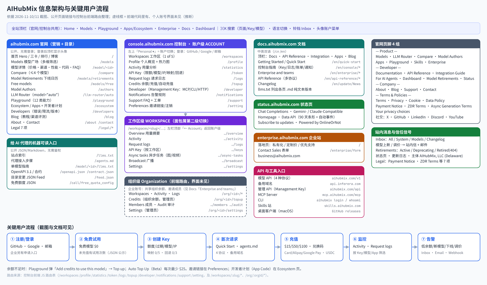

# AIHubMix 深度调研：官网、控制台与开发者体验
资料截至 2026-11-11（北京时间）。在线版：aihubmix/index.html

AIHubMix 把自己定位成「统一 AI 模型网关」（官网 Hero：The Unified Gateway for AI Models），卖点是一个 Key 调多家模型、SDK 直接替换、跨云容灾，并强调走官方云渠道（llms.txt 原文：Officially authorized model reseller, deployed on Google Cloud (US)）。它面向三类人：个人开发者（控制台 + Playground）、AI 代理（llms.txt / agents.md / MCP / CLI）、企业（独立企业站 + 销售表单 + 组织/工作区）。在 2026-11-10 的成熟度排名里它得 82 分，A 级。

## 关键发现
1. **四个子域各管一件事**：官网 aihubmix.com 负责模型目录和营销，console.aihubmix.com 是控制台，docs.aihubmix.com 是文档，status.aihubmix.com 是状态页，enterprise.aihubmix.com 面向企业。官网和控制台的顶栏基本一致，未登录看目录、登录后点 Dashboard 进控制台，路径很短。
2. **控制台分「账户 → 工作区」两层，代码里还有「组织」层**：左栏 ACCOUNT 级 10 项（工作区、Profile、Activity、API Key、日志、Credits、Developer、通知、支持、偏好）；进入工作区后左栏换成 WORKSPACE 级 7 项，面包屑「Personal / Default workspace」两级都能下拉切换。个人账号最多 5 个工作区（显示「1 of 5」）。前端路由里还有 /org/:orgId/ 下的成员、审计、组织余额（界面未见，属推断）。
3. **API Key 是一个「策略对象」**：创建抽屉一次填完：所属工作区、额度上限、过期时间、可用模型范围、IP 限制、结构化输出修复、模型名映射（BETA，最多 5 条）、出错回退模型（BETA，最多 3 个）。也就是说，路由、限额、白名单这些原本藏在后台的能力，下放给了每个 Key。
4. **价格信息在列表页就给全**：模型卡直接显示输入/输出单价、上下文、TTFT、吞吐。限时折扣用粉色胶囊写「10% off · 起止日期」，并划掉原价。详情页把同一模型的不同渠道（如 Azure / OpenAI）并排比较价格、缓存、精度、延迟、吞吐和 Uptime。图像模型按「质量×尺寸」矩阵计价，视频按秒、按分辨率计价。还有 Compare（最多 4 个）和 Router 评分表。
5. **模型生命周期和服务状态都公开**：Model Retirements 页列出计划下线 12 个、已下线 120 个，分 Active / Deprecating / Retired 三种状态，并给出替代模型。下线模型返回 404 model_retired，目录里删掉的返回 410。状态页按协议拆组件（Chat Completions / Gemini / Claude 兼容），可以看到 Gemini 兼容接口 90 天可用率 92.91%，11 月 4 日有事件。Inbox 单独有 Models 页签，新模型和调价都会推送。
6. **把 AI 代理当作一类正式用户**：公开 llms.txt、agents.md、每个模型一份 llms.txt、openapi.json、contract.json、feed.json；控制台 Developer 页用一把 Management Key 同时驱动 MCP（12 个工具）、CLI（11 条命令）和 HTTP（9 个端点），每个工具都标注需要什么凭证、是否计费。错误响应带 tid 追踪号，工单表单里有 Trace ID 字段，排障链路是通的。
7. **充值、余额和告警形成闭环**：充值弹窗：$15 / $50 / $100 预设 + 自定义，手续费写「Covered by AIHubMix」，支持 Alipay / 卡 / Google Pay；另有兑换码、USDC（x402）、自动充值（Beta，每次最少 $25）。余额为 0 时 Playground 直接弹「Add credits」。通知页默认低余额阈值 $1，推送到 Inbox + 邮件，也可以发 Webhook（文档写明支持 Lark / Slack / Discord / Teams）。
8. **有几处没对齐的地方**：模型数量的口径前后不一：首页写 730+，/models 显示 954，下线页写 Browse all 961，企业站和 llms.txt 写 500+。发票只能走工单申请。管理 API 的 GET /api/user/token 会轮换 Key（页面有黄色警告，但 GET 带副作用本身就是坑）。注册时我方域名邮箱被直接拒绝（「not allowed to access this application」），没有说明原因。

## 站点架构图

架构图依据三类来源：①截图里看到的导航和页面；②官网 HTML 里的链接和页脚；③控制台前端 JS 里的路由表。控制台页面的地址是从路由表推断出来的（截图时地址栏不可见）。工作区内页的地址带账号自己的 slug，所以「原网页」统一链接到 /workspaces。组织级（/org/:orgId/*）只在代码里出现，个人账号界面没有看到，图中用虚线框标出。

Mermaid 源码见 architecture.mmd。

## 信息架构与导航
### 顶栏与全局组件
- **官网顶栏**：Models / Playground / Ecosystem / Enterprise / Docs / Dashboard；登录后右上角显示头像。
- **控制台顶栏**：Home / Models / Playground / Apps / Enterprise / Docs，加 ⌘K 搜索、语言菜单、铃铛（Inbox）。两边的主菜单几乎一致，用户从控制台回到模型目录不会迷路。
- **⌘K** 能搜三类对象：页面、API Key、模型，默认列出「Latest models · November 2026」。中转站控制台里少有这一层。
- **Inbox 抽屉**分 All / System / Models / Changelog 四个页签，模型类消息带海报、价格和「View model」按钮。

### 控制台左栏（两层）
| 层级 | 入口 | 菜单 |
|---|---|---|
| 账户级 ACCOUNT | 左上角「Personal ▾」 | Workspaces · Profile · Activity · API Key · Request logs · Credits · Developer · Notifications · Support · Preferences |
| 工作区级 WORKSPACE | 面包屑第二级 / 工作区列表 | Overview · Activity · Request logs · API Key · Async tasks · Broadcast · Settings（「← Account」返回） |
| 组织级（推断） | 前端路由 /org/:orgId/ | Workspaces · Statistics · Logs · Topup · Members · Audit · Settings（管理员） |

### 页脚 4 组
- **Product**：Models · LLM Router · Compare · Model Authors · Apps · Playground · Skills · Enterprise
- **Developer**：Documentation · API Reference · Integration Guide · For AI Agents · Dashboard · Model Retirements · Status
- **Company**：About · Blog · Support · Contact
- **Terms & Policies**：Terms of Service · Privacy Policy · Cookie Policy · Data Policy · Payment Notice · ZDR Terms · Async Generation Terms · Your privacy choices

页脚把「For AI Agents」「Model Retirements」「Status」放在 Developer 组，说明它把这几项当作开发者的日常工具，而不是边角信息。

## 账户 / 工作区模型
### 账户 vs 工作区：AIHubMix 怎么切
- **账户（Personal）** 管钱和人：余额、充值、发票、通知、偏好、Management Key、支持工单都在账户级。
- **工作区** 管用量：每个工作区有自己的 Overview、Activity、日志、Key、异步任务、广播和设置。Key 创建时必须选择所属工作区，Key 列表有 Workspace、Belongs to 两列。
- **数量与标识**：工作区有 slug（创建后不能改），个人账号配额为 5 个（「1 of 5」）。
- **企业**：文档「Enterprise and teams」写了组织余额、工作区、成员，以及成员 Key 和系统 Key 的区别；前端有 /org/ 路由、成员邀请（/invite/org）和审计页。

> 推断：AIHubMix 的数据模型大致是「组织/个人账户（钱包）→ 工作区（项目）→ Key（策略）」，用量和日志都挂在 Key 上，再按工作区汇总。对中转站来说，最低成本的落地方式是把「分组/令牌分组」包装成「项目」，先不做多成员。

## 计费、余额与价格展示
### 充值与余额
- **Credits 页**：Total available（余额）+ Set balance reminder；Pay as you go（卡 / Alipay / Link）；Redeem code（兑换码）；Paying with USDC (x402)?；Recent transactions；发票通过工单申请。
- **充值弹窗**：$15 / $50 / $100 + 自定义；Processing fee「Covered by AIHubMix」；Alipay / Card / Google Pay；底部显示当前充值的账户，避免充错号。
- **自动充值（Beta）**：先保存卡，余额低于阈值自动扣款，每次最少 $25（文档同样写了最低 $15 的 Stripe 充值和 $25 的自动充值）。
- **免费额度**：公开接口 free_quota_config 返回：未付费试用 10 次、每分钟 10 次、每日 100 次、每日 100 万 tokens，累计付费满 $1 视为付费用户，并给出免费模型的权重表。门槛写成 JSON 公开，方便代理和用户自己判断。

### 价格展示
- **模型广场 /models**：多维筛选（输出模态、类别、厂商、Refine 排序和输入模态），顶部显示「954 models」和 Models API 入口。卡片有输入/输出价、Context、TTFT、Throughput、New 标、Copy ID。第一张卡就是 auto 路由。
- **折扣**：粉色胶囊「10% off · 起止时间」+ 划线原价；免费模型直接显示 $0。
- **详情页**：Pricing 区先给单价；Providers 区让同一个模型的多个渠道并排比较（价格、缓存价、精度、延迟、吞吐、Uptime）；Performance 区有 Uptime / Latency / Throughput 三张图；Usage 区有柱状图；还有 Try this model 代码、FAQ、Compare 入口和 More models。
- **非文本模型**：图像按 Quality（Low / Medium / High / Auto）× 尺寸（1024×1024 等）给单张价格矩阵；视频按秒计价并按分辨率列出（如 720p $0.0846/s、1080p $0.141/s）。
- **Compare**：最多 4 个模型，比较价格、上下文、TTFT / 吞吐、LMArena 分数、真实用量和月成本估算，选择会写进 URL 方便分享。
- **LLM Router**：model="auto"，四种策略（auto / balanced / quality_first / latency_critical），用 X-Aihubmix-Session-Id 做会话粘性来保住缓存命中；评分表按任务分类给每个候选模型的得分、价格、TTFT，并标出 Current pick。

## 开发者体验
### 文档
- **docs.aihubmix.com** 有中英两版（/cn、/en），顶部是 Docs / API Reference / Integration Guide / Apps / Blog / Changelog。
- **Product Introduction** 页有蓝色提示，让 AI 代理先读 llms.txt / agents.md；每页有 Copy page，底部常驻「Ask a question」。
- **Quick Start** 同时给出主域名和备用域 api.inferera.com，代码分 Python / JavaScript / Curl 三个页签。
- **API Reference** 是三栏布局：左侧端点树（OpenAI / Anthropic / Vertex / Unified / Platform API），中间说明，右侧请求/响应示例，可以 Try it。
- **Changelog** 按发布日期列出新增模型。

### 面向 AI 代理（For AI Agents）
- **协议**：同时支持 /v1/chat/completions、/v1/responses、/v1/messages、/gemini/v1beta 四种；图像、视频走 /ai/v1，以异步任务方式返回。
- **机器可读文件**：llms.txt、llms-full.txt、agents.md、/model/<id>/llms.txt、openapi.json、contract.json、feed.json。
- **错误与限流**：错误响应带 tid；限流用 RateLimit 响应头；弃用用 RFC 9745 / 8594 的 Deprecation / Sunset 头；下线模型返回 404 model_retired，目录删除的返回 410。

### Developer 页：MCP / CLI / HTTP
- **一把 Management Key**：MCP、CLI、HTTP 三条路共用，页面顶部直接给出（截图已遮挡）。
- **MCP**：可选客户端 Claude Code / Cursor / VS Code / Codex / Claude Desktop。工具表共 12 个：5 个不需要凭证，3 个需要 Management Key，4 个需要 API Key（其中 3 个计费）。下方有「Try asking」示例和排障折叠区。
- **CLI**：分三步 Install → aihubmix login → aihubmix whoami；命令表 11 条，标注 Read / Write；另有 Scripts and CI 的环境变量示例。
- **HTTP**：REST 基址 https://aihubmix.com/api，9 个端点，用 Read / Write / Destructive 彩色标签区分；黄色警告提示 GET /api/user/token 会轮换 Management Key。

> 对中转站的意义：多数 new-api 系的站只有「复制 Key + Base URL」。AIHubMix 把「让代理自己接入」做成了产品功能。我们不必一步做到 MCP，但 llms.txt / agents.md 加一页错误码文档，成本很低。

## 信任信号
- **主体与法务**：运营主体是 AIHubMix, LLC（美国特拉华州）。法务页有 7 份文件（服务条款、隐私、Cookie、支付说明、ZDR、异步生成条款等），隐私政策最后更新于 2026-09-08。Payment Notice 写明：如果无法继续提供服务，会退还剩余预付余额（扣除相关费用后）。
- **公开状态页**：status.aihubmix.com 使用 OnlineOrNot，按协议拆成 5 个组件：Chat Completions 99.96%、Gemini-Compatible 92.91%、Claude-Compatible 99.3%、Homepage 100%、Data API 100%，并保留自动化事件记录，可订阅更新。
- **模型下线日历**：公告日、下线日、替代模型都公开，并配合 404 model_retired 错误码和弃用响应头。
- **渠道透明**：详情页列出每个渠道（云厂商）的价格、精度和 Uptime；博客里有大量「同一模型、不同云渠道」的评测文章。
- **客服链路**：Support 页先给常见问题卡片（401/403/429、连不上、有余额仍报错），再提供工单表单（含 Trace ID、附件、0/10000 字的描述框）。账户注销要 15 个工作日审核。
- **社会证明**：生态页显示 25 个集成、1.3M+ GitHub stars、42k+ Dify 安装量；企业站显示 500+ 模型、40+ 云推理商、每周 1T+ tokens、99.9% Uptime。这些数字是 AIHubMix 自己公布的，本次未能核实。

## 增长
- **邀请**：邀请链接放在 Preferences 页（带 Copy 按钮），入口不显眼。本次没有看到邀请奖励规则的页面。
- **生态 / 开发者计划**：Ecosystem 页列出主流 AI 工具（Coding Agents、Agents & Workflows、Chat Clients、Developer Tools），卡片标注 Built-in / Compatible / Official plugin / Package。「Build with AIHubMix」是两步表单（App 名、网站、类别、一句话描述、Logo），卖点是 Top models / Failover / Partner rates。还有 App Code 接入说明（推断：用于把调用归因到 App，配合日志和 Activity 里的 App 维度）。
- **企业漏斗**：注册卡片下方有一行「Enterprise customer? Apply for enterprise access」→ 企业站（独立子域，衬线大标题，私有化部署、定制价、优先支持、迁移协助）→ Contact Sales 表单（月推理花费区间、合规需求：私有化 / DPA 勾选）→ business@aihubmix.com。
- **内容**：博客分 Tutorial / Opinion / News / Provider Benchmark / Announcement / Changelog，用渠道评测文章获取搜索流量（推断）。
- **桌面客户端**：首页提供 macOS 桌面版下载（GitHub releases）。

## 视觉风格
- **字体**：界面用 Plus Jakarta Sans，代码用 Geist Mono；企业站、Router、Compare、Retirements 等页的大标题用 Old Standard TT 衬线体（企业站还用了 Inter）。衬线标题让这些「专题页」显得更正式，但一个站同时用了三四套字体。
- **颜色**：主色 --ah-primary #2563eb（偏深的蓝），背景 #fcfcfe，卡片纯白，CSS 里还有深色背景 #0b0d10（推断：支持深色模式，本次未截图）。折扣胶囊用粉色 #eb2f96，其他沿用 antd 色板。
- **形状**：圆角很小（4 / 6 / 8 px），细线分隔，阴影很少，整体是偏「工具型」的干净风格。
- **组件**：控制台基于 React + antd。右侧抽屉用于创建和配置（Key、告警、工单），表格支持列设置（拖拽、钉住、密度），用面包屑切换层级。
- **密度**：Activity 是 KPI 行加 7 张图；模型卡信息很密，但排得整齐。
- **问题**：/models 的筛选区和标签占掉了不少首屏高度（2026-11-10 调研时也提过）；控制台首页加载时只显示一个标题，空态比较单薄。

## 页面逐一解析
### 登录与注册
#### 登录 / 注册弹窗
- 截图 `auth-signin`《登录弹窗（GitHub/Google/邮箱）》 原网页：https://console.aihubmix.com/sign-in（路由推断，需登录）
- 截图 `auth-signup`《注册弹窗（含企业入口）》 原网页：https://console.aihubmix.com/sign-up（需登录）
- 截图 `auth-signup-blocked`《注册被拦截：邮箱域名不被允许》 原网页：https://console.aihubmix.com/sign-up（需登录）
- **布局与组件**：未登录访问控制台任何页面，背景虚化并居中显示登录卡；提供 GitHub、Google、邮箱三种方式。注册卡要求勾选条款，下方单独一行企业入口。
- **UX 观察**：优点：登录后回到原来要访问的页面（推断，依据：卡片盖在目标页上）。企业入口在注册环节就出现。问题：我方域名邮箱被直接拒绝，没有说明原因，也没有其他途径。
- **对我们**：登录卡上方保留目标页的轮廓，能减少用户「我在哪」的困惑；被拒时应该说明原因（例如域名黑名单）并给出联系方式。

### 控制台 · 账户级
#### 控制台首页
- 截图 `c-dashboard`《控制台首页（加载态）》 原网页：https://console.aihubmix.com/
- **布局与组件**：标题「AIHubMix Dashboard」加副标题，左栏是 ACCOUNT 级 10 项菜单。
- **UX 观察**：截图时处于加载态，只有标题。（真实首页内容本次未见完整版。）
- **对我们**：首页应该直接给余额、本月花费、快速创建 Key、第一段请求代码。

#### Workspaces 工作区
- 截图 `c-workspaces`《Workspaces 工作区列表》 原网页：https://console.aihubmix.com/workspaces（需登录）
- 截图 `c-workspace-create`《新建工作区弹窗》 原网页：https://console.aihubmix.com/workspaces?create=1（需登录）
- 截图 `c-ws-switch`《工作区切换下拉》 原网页：https://console.aihubmix.com/workspaces/default/overview（需登录）
- **布局与组件**：表格列：Name / Description / Spend / Keys / Actions；右上角显示配额「1 of 5」；新建弹窗填 Name、Slug（创建后不可改）、Description。
- **UX 观察**：默认工作区带 Default 标；面包屑可以直接切换或新建工作区。
- **对我们**：把「令牌分组」包装成「项目 / 工作区」，每个项目单独显示花费和 Key 数。

#### Profile 个人概览
- 截图 `c-profile`《Profile 个人概览》 原网页：https://console.aihubmix.com/profile（需登录）
- **布局与组件**：三张 KPI 卡（本月花费、请求数、总 tokens）+ GitHub 风格的年度调用热力图 + API Key 概况表。
- **UX 观察**：热力图有趣味，也让人产生「连续使用」的感觉；概况表让用户一眼看到各 Key 的花费。
- **对我们**：可放在 P2：先做 KPI 卡和 Key 概况，再考虑热力图。

#### Activity 用量分析
- 截图 `c-activity`《Activity 用量分析（整页）》 原网页：https://console.aihubmix.com/statistics（需登录）
- 截图 `c-activity-filter`《Activity 筛选（Model/Provider/App/API key）》 原网页：https://console.aihubmix.com/statistics（需登录）
- 截图 `c-activity-range`《Activity 时间范围》 原网页：https://console.aihubmix.com/statistics（需登录）
- **布局与组件**：一行 KPI（总花费、请求数、Token 量、缓存命中率、混合单价 $/1M）+ 7 张图（Top API Keys、Top apps、按模型用量、用量类型、按模型请求量、Token 构成、Prompt 缓存）；筛选维度 Model / Provider / App / API key；时间范围从 Today 到 Past year，支持自定义；右上角可选时区（截图为 GMT-5）。
- **UX 观察**：缓存命中率和混合单价两项指标很少见，能直接回答「我花得值不值」。时区可选，避免按 UTC 统计造成误解。
- **对我们**：中转站用户最常问「钱花哪了」：P1 做按 Key / 模型的花费图和缓存命中率；时区默认设成 Asia/Shanghai。

#### API Key 列表与创建
- 截图 `c-keys-loading`《API Key 列表》 原网页：https://console.aihubmix.com/token（需登录）
- 截图 `c-key-create`《创建 API Key 抽屉》 原网页：https://console.aihubmix.com/token（需登录）
- **布局与组件**：列表列：Name/key、Workspace、Belongs to、本月花费、Limit、Expires、Last used，支持状态筛选、搜索、导出。创建用右侧抽屉：Workspace、Name、Credit limit、Structured Output Repair、Expires、模型范围、IP 限制、模型名映射（0/5）、失败回退（0/3）。
- **UX 观察**：字段多，但抽屉分段清楚，BETA 功能有标注和数量上限（0/5、0/3）。Last used 帮助清理不用的 Key。
- **对我们**：P0：额度、过期、模型白名单、IP 白名单；P1：模型映射、失败回退（new-api 渠道层已有类似能力，可以下放到 Key）。

#### Request logs 请求日志
- 截图 `c-logs`《Request logs 请求日志》 原网页：https://console.aihubmix.com/logs（需登录）
- 截图 `c-logs-filter`《请求日志筛选》 原网页：https://console.aihubmix.com/logs（需登录）
- 截图 `c-logs-columns`《请求日志列设置》 原网页：https://console.aihubmix.com/logs（需登录）
- **布局与组件**：列：Date / Model / Provider / App / Input / Output / Cost / Finish reason；筛选器可搜索（Model / App）；Table settings 支持拖拽排序列、钉住列、调整密度。（API Key 列表页有 Export CSV；日志页本次未见导出按钮。）
- **UX 观察**：空态文案会建议「试试更长的时间范围」。Finish reason 一列帮助排查截断问题。
- **对我们**：日志加 Finish reason 和 trace id，并支持列设置，对排障很有用。

#### Credits 余额与充值
- 截图 `c-credits`《Credits 余额与充值》 原网页：https://console.aihubmix.com/topup（需登录）
- 截图 `c-credits-autotopup`《Credits：Auto Top Up + 语言菜单》 原网页：https://console.aihubmix.com/topup（路由推断，需登录）
- 截图 `c-purchase`《Purchase Credits 充值弹窗》 原网页：https://console.aihubmix.com/topup（需登录）
- **布局与组件**：详见概览页「计费、余额与价格展示」。右侧是 Auto Top Up 卡片；顶栏语言菜单列出十余种语言（中、日、德、西、法、葡、俄、波、荷、意、越、乌等）。
- **UX 观察**：手续费由平台承担，并在弹窗里明说；底部显示当前账户，防止充错号；发票要走工单，比较麻烦。
- **对我们**：P0：预设金额 + 支付方式 + 兑换码 + 交易记录；把发票入口做成自助表单。

#### ⌘K 全局搜索
- 截图 `c-cmdk`《⌘K 全局搜索》 原网页：https://console.aihubmix.com/topup（路由推断，需登录）
- **布局与组件**：弹层搜索页面、API Key、模型三类对象，默认显示最新模型，底部有键盘操作提示。
- **UX 观察**：高级用户可以不碰菜单直接跳转。
- **对我们**：P1：先做「搜模型 + 搜页面」。

#### Inbox 站内信
- 截图 `c-inbox`《Inbox 站内信抽屉》 原网页：https://console.aihubmix.com/topup（路由推断，需登录）
- **布局与组件**：铃铛打开右侧抽屉，四个页签：All / System / Models / Changelog；模型消息卡片带海报、价格和「View model」。
- **UX 观察**：把上新、调价、下线这类消息集中起来，减少用户去群里追公告。
- **对我们**：P1：站内信 + 公告页签；新模型消息直接链接到模型详情页。

#### Developer：MCP / CLI / HTTP
- 截图 `c-developer-mcp`《Developer：MCP Server（整页）》 原网页：https://console.aihubmix.com/developer（需登录）
- 截图 `c-developer-cli`《Developer：CLI》 原网页：https://console.aihubmix.com/developer（需登录）
- 截图 `c-developer-http`《Developer：HTTP API》 原网页：https://console.aihubmix.com/developer（需登录）
- **布局与组件**：三个页签共用一把 Management Key。MCP 页签选客户端，看 12 个工具（凭证类型 / 是否计费）；CLI 页签分三步安装，11 条命令；HTTP 页签列 9 个端点，带 Read / Write / Destructive 标签。
- **UX 观察**：每个工具都写清凭证和计费，信息透明；但 GET 接口会轮换 Key，属于设计上的坑。
- **对我们**：P2：先做只读的管理 API（余额、用量、Key 列表），所有写操作用 POST。

#### Notifications 通知
- 截图 `c-notifications`《Notifications 通知规则（整页）》 原网页：https://console.aihubmix.com/notifications（需登录）
- 截图 `c-notify-lowbalance`《低余额告警配置抽屉》 原网页：https://console.aihubmix.com/notifications（需登录）
- **布局与组件**：分组：Budget & Spend / Models / Account & Services / Delivery destinations。规则包括低余额、新模型、模型下线、模型调价、产品更新、促销、安全告警。低余额抽屉里填阈值（默认 $1）和推送方式（Inbox / Email 必选，Webhook 可选）。
- **UX 观察**：每条规则是一个开关加一个配置抽屉，结构清晰；Webhook 作为独立的「目的地」统一管理。
- **对我们**：P0：低余额邮件告警；P1：下线 / 调价通知 + Webhook（企业微信 / 飞书 / 钉钉）。

#### Support 支持
- 截图 `c-support`《Support 支持 + 新建工单》 原网页：https://console.aihubmix.com/support（需登录）
- **布局与组件**：先列常见问题卡片（401 / 403 / 429、连不上、有余额仍失败）→ Browse all FAQs；New ticket 抽屉：回复邮箱、分类、标题、描述（0/10000）、附件、Trace ID。
- **UX 观察**：先让用户自助排查，再开工单；Trace ID 让客服能直接定位请求。
- **对我们**：P0：错误码 FAQ；P1：工单带 trace id（中转站常见的「群里截图问客服」可以由此减少）。

#### Preferences 偏好设置
- 截图 `c-preferences`《Preferences 偏好设置》 原网页：https://console.aihubmix.com/setting（需登录）
- 截图 `c-account-menu`《账户切换菜单（左上角）》 原网页：https://console.aihubmix.com/workspaces（需登录）
- **布局与组件**：Personal account（Manage account）、Balance reminder、Invite link + Copy、Personal account deletion（红色危险区，15 个工作日审核）。左上角头像下拉是账户级菜单全集 + Sign out。
- **UX 观察**：危险操作单独放在红色区域；邀请入口放得比较深。
- **对我们**：如果邀请是我们的主要增长手段，入口应该放到首页或顶栏。

### 控制台 · 工作区级
#### 工作区 Overview
- 截图 `c-ws-overview`《工作区 Overview（工作区级导航）》 原网页：https://console.aihubmix.com/workspaces/default/overview（需登录）
- **布局与组件**：面包屑两级（Personal / Default workspace）；左栏换成 WORKSPACE 级 7 项；Usage summary 可以切换 Tokens / Spend / Requests。
- **UX 观察**：用户能明确感知「现在在哪一层」；「← Account」随时返回账户级。
- **对我们**：做项目层时，用面包屑而不是另起一套导航。

### 官网 · 模型与价格
#### 官网首页
- 截图 `p-home`《官网首页（整页，未登录）》 原网页：https://aihubmix.com/
- **布局与组件**：Hero「The Unified Gateway for AI Models」+ 三个要点（730+ models / Official cloud routes / Pay as you go）→ 三张卖点卡（一个 Key、SDK 直接替换、跨云容灾）→ 桌面客户端 → 生态 → Model Rankings → Blog → 四列页脚。
- **UX 观察**：首屏用一句话讲清楚定位，往下是证据（渠道、排行、生态）；但首页的 730+ 和模型广场的 954 对不上。
- **对我们**：首页三件事：一句话定位、价格入口、「3 步接入」代码。

#### Models 模型广场
- 截图 `p-models`《Models 模型广场》 原网页：https://aihubmix.com/models
- 截图 `p-models-2`《Models：折扣与免费标记》 原网页：https://aihubmix.com/models
- **布局与组件**：左侧筛选（输出模态 / 类别 / 厂商 / Refine）+ 右侧卡片网格；顶部显示模型数和 Models API 入口。
- **UX 观察**：价格、上下文、速度在列表页就能比较；折扣胶囊很醒目。筛选区偏高，首屏能看到的卡片少。
- **对我们**：P0：价格页卡片显示「输入 / 输出价 + 上下文 + 折扣划线」，筛选区默认收起。

#### 模型详情
- 截图 `p-model-detail`《模型详情：GPT 6.1 Terra》 原网页：https://aihubmix.com/model/gpt-6.1-terra
- 截图 `p-model-detail-full`《模型详情整页缩略》 原网页：https://aihubmix.com/model/gpt-6.1-terra
- 截图 `p-model-image`《图像模型详情：GPT Image 2.6 Flare》 原网页：https://aihubmix.com/model/gpt-image-2.6-flare
- 截图 `p-model-video`《视频模型详情：Wan2.7 T2V》 原网页：https://aihubmix.com/model/wan2.7-t2v
- **布局与组件**：左侧锚点导航，右侧依次是 Pricing → Specifications → Providers → Performance → Usage → Try this model → FAQ → Compare → More models。能力清单里不支持的项灰显。
- **UX 观察**：把「这个模型多少钱、走哪个渠道、稳不稳、怎么调」放在一页里讲清楚。
- **对我们**：P1：每个模型一页详情：价格、上下文、能力、示例代码；P2：渠道 Uptime。

#### Compare 对比
- 截图 `p-compare`《Compare 模型对比》 原网页：https://aihubmix.com/compare
- **布局与组件**：最多 4 个模型并排，选择写进 URL，下方列出 Popular comparisons。
- **UX 观察**：可分享的 URL 带来 SEO 和社群传播（推断）。
- **对我们**：P2。

#### LLM Router
- 截图 `p-router`《LLM Router：model="auto"》 原网页：https://aihubmix.com/llm-router/auto
- 截图 `p-router-table`《LLM Router：分类评分表》 原网页：https://aihubmix.com/llm-router/auto
- **布局与组件**：左边是策略说明，右边是代码窗口；下方评分表按任务分类给每个候选模型打分，并显示价格和 TTFT。
- **UX 观察**：公开的评分表让「auto」不再是黑盒。
- **对我们**：P2：如果要做「智能路由」，先公开路由规则。

#### Model Retirements 模型下线
- 截图 `p-retirements`《Model Retirements 模型下线》 原网页：https://aihubmix.com/models/retirements
- **布局与组件**：顶部统计 12 个计划下线、120 个已下线；说明三种状态；按厂商筛选；表格列出公告日、下线日、替代模型。
- **UX 观察**：这是同类站里少见的页面，直接回答「我用的模型还能用多久」。
- **对我们**：P1：中转站模型变动频繁，一个公告日历加替代建议就能明显减少客服压力。

### 官网 · Playground
#### Playground
- 截图 `p-playground-gate`《Playground（未登录）》 原网页：https://aihubmix.com/playground
- 截图 `p-playground-text`《Playground：文本》 原网页：https://aihubmix.com/playground
- 截图 `p-playground-credit`《Playground：余额不足拦截》 原网页：https://aihubmix.com/playground
- 截图 `p-playground-image`《Playground：图像参数》 原网页：https://aihubmix.com/playground
- 截图 `p-playground-video`《Playground：视频参数》 原网页：https://aihubmix.com/playground
- **布局与组件**：左栏 12 类能力（Text / Image / Speech / Video / Transcription / Realtime / Embeddings / Rerank / OCR / Moderation / Search / Decision），中间是模型卡（价格、上下文、Provider），右边是参数面板。图像参数：6 种比例、宽高、png / jpeg / webp / gif / svg；视频参数：7 种比例、480P / 768P、5 秒。
- **UX 观察**：未登录先弹登录，余额为 0 时弹充值，「试用 → 付费」的转化路径很短。历史只保存在本机，页面上有说明。
- **对我们**：P1：网页版 Playground（先做文本 + 图像），余额不足时直接引导充值。

### 官网 · 生态与企业
#### Ecosystem / Apps
- 截图 `p-ecosystem`《Ecosystem / Apps 生态首屏》 原网页：https://aihubmix.com/ecosystem
- 截图 `p-ecosystem-list`《Ecosystem：分类浏览》 原网页：https://aihubmix.com/ecosystem
- 截图 `p-ecosystem-full`《Ecosystem 整页缩略》 原网页：https://aihubmix.com/ecosystem
- 截图 `p-ecosystem-dev`《Ecosystem：开发者计划表单》 原网页：https://aihubmix.com/ecosystem
- **布局与组件**：首屏三个社会证明数字 + Featured 卡片；下面依次是分类浏览、社区应用、开发者计划表单、App Code 说明和 FAQ。
- **UX 观察**：卡片标注集成方式（Built-in / Compatible / Plugin / Package），用户可以判断接入难度。
- **对我们**：P1：「在 Cherry Studio / Cursor / Claude Code 里怎么用」的教程卡片，对中转站用户最实用。

#### Enterprise 企业站
- 截图 `p-enterprise`《Enterprise 企业站首屏》 原网页：https://enterprise.aihubmix.com/
- 截图 `p-enterprise-full`《Enterprise 整页缩略》 原网页：https://enterprise.aihubmix.com/
- 截图 `p-contact-sales`《Contact Sales 销售表单》 原网页：https://enterprise.aihubmix.com/enterprise/form
- **布局与组件**：独立子域、衬线大标题、四个大数字、三种协议代码切换；Contact Sales 表单收集月花费区间和合规需求。
- **UX 观察**：把企业销售和自助控制台分开，各自讲各自的话。
- **对我们**：P2：先做一个「企业 / 团队采购」表单页即可。

### 官网 · 信任与内容
#### About 与页脚
- 截图 `p-about`《About 关于》 原网页：https://aihubmix.com/about
- **布局与组件**：主体信息、联系邮箱、四列页脚。
- **UX 观察**：主体和联系方式放在显眼位置。
- **对我们**：P0：写明主体（公司 / 个人）、联系方式、服务条款。

#### Blog
- 截图 `p-blog`《Blog 博客（整页）》 原网页：https://aihubmix.com/blog
- **布局与组件**：分类标签 + 卡片列表；有大量渠道评测文章。
- **UX 观察**：内容同时起到教育用户和 SEO 的作用（推断）。
- **对我们**：P2。

#### 法务页
- 截图 `p-legal-payment`《Payment Notice 支付说明》 原网页：https://aihubmix.com/legal/payment
- 截图 `p-legal-privacy`《Privacy Policy 隐私政策》 原网页：https://aihubmix.com/legal/privacy
- 截图 `p-legal-terms`《Terms of Use 服务条款》 原网页：https://aihubmix.com/legal/terms
- **布局与组件**：左侧法务导航 7 项，右侧正文。
- **UX 观察**：退款条款写得清楚，有助于建立信任。
- **对我们**：P0：至少有服务条款、隐私政策、退款说明三页。

### 文档与状态页
#### 文档首页与 Quick Start
- 截图 `d-intro`《Docs：Product Introduction》 原网页：https://docs.aihubmix.com/en
- 截图 `d-quickstart`《Docs：Quick Start》 原网页：https://docs.aihubmix.com/en/quick-start
- **布局与组件**：详见概览页「开发者体验」。
- **UX 观察**：先给备用域名，再给三种语言的代码。
- **对我们**：P0：Quick Start 一页讲清 Base URL、Key、三种语言示例和常见报错。

#### API Reference
- 截图 `d-apiref`《API Reference：Create a Chat Completion》 原网页：https://docs.aihubmix.com/en/api-reference/openai-compatible/create-a-chat-completion
- **布局与组件**：三栏布局，支持 Try it。
- **UX 观察**：左侧端点树按协议分组，适合多协议网关。
- **对我们**：P1。

#### Changelog
- 截图 `d-changelog`《Changelog 更新日志》 原网页：https://docs.aihubmix.com/en/update/News
- **布局与组件**：按日期列出新增模型。
- **UX 观察**：和 Inbox 的 Changelog 页签互相呼应。
- **对我们**：P1：更新日志页。

#### Status 状态页
- 截图 `s-status`《Status 状态页》 原网页：https://status.aihubmix.com/
- **布局与组件**：按协议拆组件，90 天条形图 + 事件记录，使用第三方服务托管。
- **UX 观察**：即使可用率不好看（Gemini 92.91%）也公开展示，反而显得可信。
- **对我们**：P1：用 Uptime Kuma 等工具做公开状态页，按协议 / 模型族拆分组件。

## 对我们中转站用户端的借鉴
### P0
1. **控制台首页 = 余额 + 本月花费 + 「创建 Key → 复制代码」**：对应 AIHubMix 的 Profile KPI 卡和 Quick Start。新用户 1 分钟内能完成第一次请求。首页不要只放一个标题或营销图。
2. **Key 创建抽屉：额度 / 过期 / 模型白名单 / IP 白名单**：对应 AIHubMix 的 Key 抽屉。new-api 后端大多已有这些字段，主要工作是重做表单分组、加上说明文字，并在列表里显示 Last used 和本月花费。
3. **请求日志：时间 / 模型 / 输入 / 输出 / 费用 / 状态 + 筛选 + 导出**：对应 Request logs。加上 trace id 和 Finish reason，并支持按 Key / 模型筛选、导出 CSV，可以减少大量「这笔扣费怎么来的」类咨询。
4. **价格页：卡片直接显示单价、上下文、折扣划线价**：对应 /models 卡片。筛选区默认收起，让首屏多显示几个模型；图像和视频用矩阵或按秒的价格表。
5. **充值弹窗：预设金额、支付方式、手续费说明、兑换码、交易记录**：对应 Purchase Credits。写清楚手续费由谁承担、最低充值金额，弹窗底部显示当前账户。
6. **低余额告警（邮件 / 站内信）**：对应 Notifications 的低余额规则。提供默认阈值，用户首次充值后自动开启。
7. **错误码 FAQ + 主体 / 条款 / 退款说明**：对应 Support 的常见问题卡片和 Legal 页。401 / 403 / 429 / 余额不足这几类错误写成一页，并在报错信息里附上链接。

### P1
1. **项目（工作区）层**：把令牌分组包装成「项目」，每个项目显示自己的花费、Key 和日志；用面包屑切换，不另起一套导航。
2. **用量分析图表**：按 Key / 模型 / 日期显示花费，展示缓存命中率；时区默认 Asia/Shanghai。
3. **模型公告：上新 / 调价 / 下线日历 + 替代建议**：参考 Retirements 页和 Inbox 的 Models 页签；下线模型返回明确的错误码。
4. **公开状态页**：按协议或模型族拆分组件（OpenAI 兼容、Claude 兼容、Gemini 兼容、图像），可以订阅。
5. **站内信 + ⌘K 搜索模型**：让新模型消息能一键跳到模型详情和 Playground。
6. **网页 Playground，余额不足时引导充值**：先做文本和图像两类。
7. **Webhook 通知（飞书 / 钉钉 / 企业微信）**：把低余额、下线、调价等事件推送到群里。
8. **llms.txt / agents.md + 模型详情页**：成本低，对 AI 编程工具用户有用。
9. **「在 XX 工具里使用」的教程卡片**：Cherry Studio、Cursor、Claude Code、Dify 等，参考 Ecosystem 页。

### P2
1. **Key 级模型映射和失败回退**：把渠道层已有的能力开放给用户，配合「BETA + 数量上限」的方式试运行。
2. **model="auto" 路由，并公开评分规则**：先公开规则，再上线功能。
3. **管理 API / CLI / MCP**：先做只读接口，写操作一律用 POST，并在页面上标注凭证和计费。
4. **Compare 对比页、模型渠道 Uptime**：需要先积累监控数据。
5. **企业 / 团队：成员、组织余额、审计、销售表单**：需求明确后再做。
6. **Profile 热力图、自动充值、多语言**：有了更好，不是必需。

### 避免
- **同一个指标在不同页面给出不同数字**：AIHubMix 的模型数有 730+ / 954 / 961 / 500+ 四种说法。我们的模型数、可用率、价格应该只从一个数据源生成。
- **筛选区占满首屏**：价格页的筛选区默认收起，或做成一行横向标签。
- **拒绝注册却不说明原因**：被风控拦截时，应该说明原因并给出申诉或联系方式。
- **GET 请求带副作用**：查询接口不能轮换 Key 或修改数据。
- **发票、退款只能走工单**：至少提供自助申请表单，并显示处理进度。
- **营销图里放看起来像真实账户的数字**：首页示意图里的余额（如 $128.40）容易被误认为是用户的真实数据，示意图应该明确标注为示例。
- **字体过多**：AIHubMix 在不同页面用了三四套字体。我们统一用一套无衬线字体加一套等宽字体即可。
- **照搬企业级复杂度**：组织、成员、审计、路由策略等功能，个人用户为主的中转站暂时用不上，先把 P0 做扎实。

## 局限与缺口
- 这次没有拿到浏览器巡检的原始报告，页面清单和地址是根据截图、官网链接和控制台前端路由重新整理的。
- 控制台页面的地址取自截图时浏览器实际访问的地址，点开需要登录；登录弹窗、⌘K、站内信和 Auto Top Up 这几张弹层截图的地址是按前端路由推断的。
- 组织级（成员、审计、组织余额）只在前端代码里出现，个人账号界面没有看到。
- 测试账号余额为 0，交易记录、请求日志、用量图表都是空的，没有看到它们有数据时的样子。
- 没有新建 API Key（账号里原本就有 2 个），也没有发起付费请求。
- 模型名称（如 GPT 6.1 Terra、GPT Image 2.6 Flare、Wan2.7）和各种统计数字都照抄页面显示，未独立核实。
- 注册时我方域名邮箱被拒，登录使用的是已有账号；控制台首页只截到了加载态。
