# AI 聚合站对比、精选与建议策划：AIHubMix × kie.ai × OpenRouter
资料截至 2026-11-11（北京时间）。在线版：compare/index.html（调研总站下）。来源编号 [ORn] 指 OpenRouter 页面，[Xn] 指其他网站，完整清单见文末。

## 一、总览与建议方向
光哥，这份报告把 [AIHubMix 深度调研](../aihubmix/index.html) 和 [kie.ai 深度调研](../kieai/index.html) 合在一起，逐模块比较两站做法，再用 OpenRouter（当前最成熟的模型聚合站）的公开文档补齐两站没有的能力，最后给出你自己的 AI 聚合站的目标形态、页面优先级和分阶段路线。AIHubMix、kie.ai 的结论均来自前两份调研（含登录巡检截图）；OpenRouter 只引用本次实际读过的公开页面和文档，每条都附来源编号，编号对应「来源清单」页。
### 一句话结论
**AIHubMix 擅长「治理」，kie.ai 擅长「卖货」，OpenRouter 擅长「路由与可信」。** 你的站最合适的组合是：**用 kie.ai 的方式标价和卖多媒体，用 AIHubMix 的方式管理 Key、日志、通知和客服，用 OpenRouter 的方式做计费规则、错误码、渠道透明和预算控制，再补上三站都没有的国内 B2B 能力（企业认证、对公充值、增值税发票、子账号与代理商）。**

> 三站都犯过同一个错：同一个指标在不同页面给出不同数字。AIHubMix 的模型数有 730+ / 954 / 961 / 500+ 四种说法，kie.ai 有 124 / 138 / 200+ / 654 行，OpenRouter 的文档写 400+ [OR5](https://openrouter.ai/docs/guides/overview/models)、价格页写 600+ [OR1](https://openrouter.ai/pricing)，Models API 默认返回 469 个文本模型、全部模态 718 个 [OR6](https://openrouter.ai/api/v1/models)。**你的站从第一天起就应该让所有对外数字来自同一个数据源，并写清口径（按模型、按价格行还是按渠道计数）。**

### 最重要的 8 条结论
1. **价格页是中转站的第一转化页，抄 kie.ai。** 每行给出「我们价 + 官方价 + 折扣 %」，多媒体按「分辨率 × 时长 × 是否带参考输入」逐行列价，并写出计费公式。AIHubMix 的「输入/输出 + 上下文 + 限时折扣胶囊」适合文本模型卡片，两者合并。OpenRouter 的做法是写明「推理价不加价，充值时收 5.5%（Standard）/ 8%（Business）平台费」[OR1](https://openrouter.ai/pricing)。你做批发转售，不必照搬零加价，但应该同样把「你的钱怎么算」一句话讲清楚。
2. **API Key 是策略对象，表单抄 kie.ai，字段抄 AIHubMix，风险视图抄 OpenRouter。** kie.ai 默认推荐 IP 白名单、能一键填入「最近调用过的 IP」；AIHubMix 把额度、过期、模型范围、IP、模型映射、失败回退放进同一个抽屉；OpenRouter 有专门的 Key 安全页，用 Risk 列标出「无限额 / 无过期」，额度 ≥ $1,000 或过期超过 365 天的 Key 也会被标出 [OR24](https://openrouter.ai/docs/guides/overview/auth/security-settings)。
3. **计费规则要写进产品，不能只写在群公告里。** kie.ai 把限流写在充值页、保留期写在日志页顶部；OpenRouter 写明空回复和报错不计费 [OR43](https://openrouter.ai/docs/guides/features/zero-completion-insurance)，回退时只按最终成功的模型计费 [OR14](https://openrouter.ai/docs/guides/routing/model-fallbacks)，并对并发请求做「在途预扣」，避免同时跑的请求把余额扣成负数 [OR56](https://openrouter.ai/docs/api_reference/limits)。中转站最常见的纠纷正是「为什么扣这么多」和「余额怎么成负的」。
4. **可信度靠公开数据，不靠首页的 99.9%。** AIHubMix 的状态页按协议拆组件，敢公开 92.91% 的低可用率；kie.ai 的「平台实时状态」点不进去。OpenRouter 不仅有按 API 端点拆分的 90 天状态页 [OR12](https://status.openrouter.ai/)，还在每个模型页按渠道公开延迟、吞吐和 Uptime [OR8](https://openrouter.ai/anthropic/claude-sonnet-4.6)，路由本身也依据这些实时数据 [OR59](https://openrouter.ai/docs/guides/best-practices/uptime-optimization)。你的 P1 应该至少做到 AIHubMix 的水平，P2 再做到按模型、按渠道公开。
5. **错误码必须用标准 HTTP 状态码。** kie.ai 的 /api/v1/* 出错也返回 HTTP 200，客户端无法按状态码重试和熔断；OpenRouter 区分 400/401/402/403/408/429/502/503，并带 Retry-After 头 [OR57](https://openrouter.ai/docs/api_reference/errors-and-debugging)；AIHubMix 的错误带 tid，工单里可以填 Trace ID。你的站：标准状态码 + 中文原因 + trace id + 工单一键带入。
6. **两站都缺「路由与容灾」这一层，这是 OpenRouter 和普通中转站的主要差距。** OpenRouter 支持同一模型按价格、吞吐或延迟给渠道排序，可以指定、排除或只用某些渠道，按价格上限、数据政策过滤 [OR13](https://openrouter.ai/docs/guides/routing/provider-selection)；也支持模型级回退数组 [OR14](https://openrouter.ai/docs/guides/routing/model-fallbacks)，用 `:floor`（最便宜）/`:nitro`（最快）后缀切换偏好 [OR18](https://openrouter.ai/docs/guides/routing/model-variants/floor) [OR17](https://openrouter.ai/docs/guides/routing/model-variants/nitro)，用 `~latest` 别名自动跟随新版本 [OR20](https://openrouter.ai/docs/guides/features/latest-resolution)。你的后端（new-api 类，推断）已有渠道权重和重试，主要工作是**把它变成用户能选、能看到结果的产品功能**，并在日志里显示每次实际走了哪个渠道、是否发生了回退。
7. **企业与团队能力，OpenRouter 的分层最清楚，但个人用户为主的站不必首发就做。** OpenRouter 的结构是：组织统一出钱，工作区隔离 Key、路由默认值和观测配置 [OR37](https://openrouter.ai/docs/guides/features/workspaces)，工作区预算按日、周、月或累计封顶 [OR38](https://openrouter.ai/docs/guides/features/workspaces/workspace-budgets)，护栏按成员或 Key 限额、限定可用模型 [OR36](https://openrouter.ai/docs/guides/features/guardrails)，再往上是 SSO/SCIM [OR47](https://openrouter.ai/docs/guides/features/sso)。对你的 B2B 客户，最先需要的是「一个企业账号 + 多个子账号/项目 + 各自额度 + 统一开票」，SSO 放到 P2。
8. **国内 B2B 的硬需求三站都没有：实名/企业认证、对公转账、增值税发票、合同和对账单。** AIHubMix 的发票要走工单；kie.ai 的发票在 Billing 页手动生成；OpenRouter 支持在发票上加税号，通过 Stripe 计税 [OR51](https://openrouter.ai/docs/cookbook/administration/tax-id)。这些都不适用于国内对公。国内可参考硅基流动：实名后才能充值和开票，企业认证可开增值税专用发票，只对已消费金额开票 [X5](https://docs.siliconflow.cn/cn/faqs/authentication) [X7](https://docs.siliconflow.cn/cn/faqs/invoice)。**这是你相对三站最容易建立的差异化。**

### 三站定位速览
| 维度 | AIHubMix | kie.ai | OpenRouter（基准） |
|---|---|---|---|
| 主打 | 文本 LLM 网关，强调「官方云渠道」 | 多媒体优先（654 个价格行里视频 365、图像 164），主打低价 | 多模型、多渠道路由；推理按渠道标价不加价，充值收平台费 [OR1](https://openrouter.ai/pricing) [OR4](https://openrouter.ai/docs/guides/overview/principles) |
| 规模口径 | 730+ / 954 / 961 / 500+（口径不一） | 124 / 138 / 200+ / 654 行（口径不一） | 600+ 模型、80+ 渠道（价格页）[OR1](https://openrouter.ai/pricing) |
| 计费单位 | 美元余额 | 积分（1 credit = $0.005） | 美元 credits；FAQ 写明保留对购买满一年未用的额度做过期处理 [OR3](https://openrouter.ai/docs/faq) |
| 账户层级 | 账户 → 工作区（个人最多 5 个），代码里有组织层 | 扁平：账户 + 团队成员 + Key | 组织 → 工作区 → 成员 / Key，护栏 + 预算 [OR37](https://openrouter.ai/docs/guides/features/workspaces) [OR36](https://openrouter.ai/docs/guides/features/guardrails) |
| 可信 | 公开状态页、模型下线日历、工单带 Trace ID | 无公开状态页；文档坦白「偶尔不稳定」 | 状态页 + 每个模型按渠道公开 Uptime；空回复不计费 [OR12](https://status.openrouter.ai/) [OR43](https://openrouter.ai/docs/guides/features/zero-completion-insurance) |
| 开发者 | 4 种协议直连；llms.txt、MCP、CLI | 统一异步任务接口；npx skills | 多协议 + SDK（TS / Python / Go）+ MCP + 每页 .md 文档 [OR60](https://openrouter.ai/docs/llms.txt) [OR49](https://openrouter.ai/docs/guides/overview/mcp-server) |
| 增长 | 邀请链接、生态页、企业站 | 15% 佣金推广（申请制）、SEO 博客 | 公开用量排行、App 归因上榜 [OR10](https://openrouter.ai/rankings) [OR48](https://openrouter.ai/docs/app-attribution) |
| 最大短板 | 发票走工单；GET 接口会轮换 Key | 错误返回 HTTP 200；隐私政策与实际不符；无工单 | 面向海外：Stripe 计税、美元计价，没有国内对公与增值税发票 |

[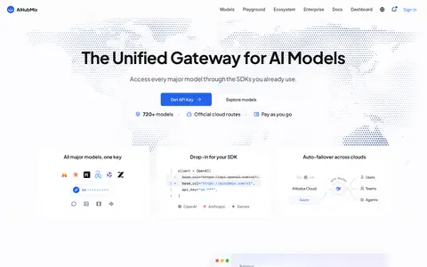](img/full/ah-p-home.webp)  [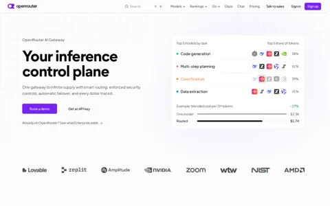](img/full/or-enterprise.webp)

### 给光哥的建议方向
#### 定位
**「面向国内开发者和中小企业的透明 AI 模型网关：一个 Key 调文本和多媒体，人民币结算，可开发票，价格、渠道、可用率都摆在明面上。」**

#### 五个核心差异化（按重要度）
1. **价格透明**：每个模型都给「我们价 / 官方价 / 折扣」，人民币直接标价（不搞积分换算）；多媒体写计费公式；同一模型不同渠道或分组的价格并排列出，渠道来源写清楚。
2. **计费可核对**：报错和空回复不扣费，回退时只按实际成功的那次计费，并发请求先预扣，日志里每条都能看到扣费明细和 trace id。规则写在价格页、充值页和日志页，而不是只写在群公告里。
3. **国内 B2B 闭环**：企业认证 → 对公转账 → 增值税发票（按已消费金额开）→ 合同与月度对账单 → 子账号/项目额度。这一块三站都没有。
4. **可信度公开**：状态页按协议和模型族拆组件；公告中心集中发布上新、调价和下线（带替代模型）；通知推送到飞书、企业微信或钉钉。
5. **多媒体与文本一体**：文本走 OpenAI / Claude / Gemini 兼容协议直连；图像、视频、音乐统一走「创建任务 + 查询 + 签名回调」，保留期写在日志页。

#### 明确不做（至少首发不做）
- 不做积分制和「看起来像真实数据」的营销数字；不在首页放点不开的「实时状态」。
- 首发不做 SSO/SCIM、私有化部署、Auto Router 和 MCP。这些是 OpenRouter 和 AIHubMix 的企业级功能，个人和小团队客户用不上，先把 P0 做扎实。
- 不照搬 kie.ai「错误也返回 200」和「回调签名不覆盖请求体」，也不照搬 AIHubMix「GET 请求会轮换 Key」。

### 分阶段路线（P0 / P1 / P2）
#### **P0** 首发（约 4～6 周的用户端重做范围，按 new-api 类后端已有能力估算，属推断）
- **价格页 + 模型广场**：我们价 / 官方价 / 折扣列，人民币标价；按模态、厂商、用途筛选，筛选状态写进 URL；多媒体按分辨率逐行列价并写计费公式。
- **模型详情页 v1**：价格表（输入、输出、缓存读、缓存写）、上下文、能力清单、可复制的代码示例（Base URL 和模型名已填好）。
- **控制台首页**：余额、本月花费、「创建 Key → 复制代码」两步完成首次调用。
- **Key 创建抽屉**：名称、额度、有效期、模型白名单、IP 白名单（默认推荐，可一键填入最近调用的 IP）；列表用警示图标标出「任意 IP / 永不过期 / 无限额」的 Key。
- **请求日志 + 任务日志**：时间、模型、渠道分组、输入/输出 tokens、扣费、状态、Finish reason、trace id；任务按 Task ID 搜索；支持 CSV 导出；保留期写在页面顶部。
- **充值页**：人民币预设金额 + 赠送比例角标 + 支付方式 + 兑换码 + 交易记录；限流规则写在同一页。
- **计费规则**：标准 HTTP 错误码；报错和空回复不扣费；并发请求预扣。
- **实名 / 企业认证 + 发票申请**：先上线表单和人工处理流程，再逐步自动化。
- **低余额告警**（邮件 + 站内信）；**错误码 FAQ + 工单（带 trace id）**；**接入必读**一页；**主体、条款、隐私、退款、发票政策**。

#### **P1** 第二阶段（上线后 1～3 个月）
- 公开状态页（按协议 / 模型族拆组件）；公告中心（上新 / 调价 / 下线日历 + 替代模型）；通知推送到飞书、企业微信、钉钉的 Webhook。
- 项目（工作区）层：把令牌分组包装成项目，每个项目单独看花费、Key 和日志，并设日、周、月预算。
- 用量分析：按 Key / 模型 / 成员统计，展示缓存命中率和混合单价；时区默认 Asia/Shanghai。
- 子账号与团队：成员、角色、额度分配；企业统一付款、统一开票。
- 网页 Playground（文本 + 图像），余额不足时直接引导充值；在常用工具里接入的教程卡片（Cherry Studio、Cursor、Claude Code、Dify）。
- 推广返佣（申请制、安全期、防刷、周结算）；付费客户专属飞书或企业微信群。
- 响应内返回 usage 和 cost；余额与 Key 查询接口；llms.txt；Changelog + RSS。

#### **P2** 远期（有数据、有企业客户之后）
- 路由偏好：渠道优先级、「经济 / 高速」两种模式、模型级回退数组、`latest` 别名；每个模型按渠道公开 Uptime、延迟和吞吐。
- 预设（模型 + 参数 + 系统提示词）、批量接口（Batch）、相同请求缓存。
- 代理商 / 分销：下级账号、加价规则、对账单（服务你的 B2B 转售客户）。
- 管理 API（先做只读）、MCP / CLI；模型对比页；本站用量排行。
- 企业：审计日志、SSO、数据不留存承诺、SLA 与赔付条款。

## 二、逐模块对比
下表按用户从「看到」到「付费」再到「持续使用」的顺序，列出 20 个模块。「更优」是站在**国内 B2B 中转站用户端**的角度判断的，不是对两站的综合评分。OpenRouter 一栏只写本次读过的公开页面和文档，带来源编号。缩略图都可以点开放大，图注里附原网页地址。
### 20 个模块速览
| 模块 | 更优 | 我们取法 |
|---|---|---|
| [注册登录](#m-auth) | AIHubMix | 保留「虚化目标页 + 登录卡」；国内补手机号、微信、邮箱；被风控拦截时说明原因并给出申诉入口 |
| [首页落地](#m-home) | kie.ai | 首屏写定位和三条承诺，接着放 6～10 个热门模型的「我们价 vs 官方价」，再放 FAQ；不放点不开的状态标签 |
| [模型广场](#m-market) | AIHubMix（卡片）+ kie.ai（URL 筛选） | 卡片信息照 AIHubMix；筛选做成可分享的 URL；筛选区默认收起 |
| [模型详情](#m-detail) | 文本看 OpenRouter / AIHubMix，多媒体看 kie.ai | 文本模型：价格 + 渠道表 + 代码；多媒体模型：参数表单 + 价格网格 + 试跑 |
| [价格页](#m-pricing) | kie.ai | 照 kie.ai 做，人民币直标；计数按模型算；对比依据（官方价或渠道价）写在表头 |
| [充值计费](#m-billing) | AIHubMix + kie.ai | 预设金额 + 赠送角标 + 手续费说明 + 兑换码；弹窗底部显示当前充值账户；退款规则写清楚 |
| [API Key](#m-keys) | kie.ai（表单）+ AIHubMix（字段）+ OpenRouter（风险视图） | P0 做表单和安全默认值；P1 做风险列表；P2 做映射和回退 |
| [请求 / 任务日志](#m-logs) | OpenRouter（深度）；AIHubMix + kie.ai（首发范围） | P0：AIHubMix 的列 + kie.ai 的 Task ID 和保留期 + trace id；P2：回退过程和上游尝试明细 |
| [用量分析](#m-usage) | AIHubMix（首发）/ OpenRouter（远期） | 先做 KPI + 按 Key / 模型的花费图；时区默认 Asia/Shanghai |
| [通知](#m-notify) | AIHubMix + OpenRouter | P0 低余额；P1 下线 / 调价 / Key 限额 + 飞书、企微、钉钉 Webhook |
| [状态页](#m-status) | AIHubMix + OpenRouter | P1 照 AIHubMix 拆组件；P2 在模型页加按渠道的可用率 |
| [模型上新 / 下线](#m-lifecycle) | AIHubMix | 公告中心 = 上新 + 调价 + 下线日历；下线模型返回明确的错误码 |
| [工单客服](#m-support) | AIHubMix | FAQ 卡片 → 工单（带 trace id）→ 付费客户专属飞书或企微群 |
| [文档](#m-docs) | kie.ai（必读页）+ OpenRouter（错误码） | P0：接入必读 + 错误码页；P1：多协议 API 参考 |
| [SDK 与代理集成](#m-agents) | AIHubMix | P1：llms.txt + 常用工具的接入教程；P2：MCP / CLI |
| [路由与容灾](#m-routing) | OpenRouter | P2：把后台渠道路由变成用户可选的「经济 / 高速」模式，并在日志里显示实际走的渠道 |
| [多媒体异步任务](#m-async) | kie.ai | 照 kie.ai 统一接口，但签名要覆盖时间戳 + 原始请求体 |
| [邀请返佣 / 增长](#m-growth) | kie.ai | 照 kie.ai 的规则，入口放到首页和顶栏；演示数据要整块置灰 |
| [企业与团队](#m-team) | OpenRouter（分层）/ AIHubMix（界面） | P1：企业账号 + 子账号 / 项目额度；P2：审计、SSO |
| [安全合规与隐私](#m-privacy) | OpenRouter | P0：政策与实际一致；P1：数据不留存承诺 + 可选私有日志（写明保留期） |
#### 注册登录
- **AIHubMix**：GitHub / Google / 邮箱；未登录时目标页虚化，上面盖一张登录卡；注册卡下方有企业入口。我方域名邮箱被拒，没有说明原因
- **kie.ai**：只有 Google / Microsoft / 手机号，不能用邮箱注册；注册后直接进入 Billing 页
- **OpenRouter**：本次未读登录页；OAuth PKCE 让第三方应用代用户授权并获得 Key [OR22](https://openrouter.ai/docs/guides/overview/auth/oauth)
- **更优**：AIHubMix
- **我们取法**：保留「虚化目标页 + 登录卡」；国内补手机号、微信、邮箱；被风控拦截时说明原因并给出申诉入口

AIHubMix 的「虚化目标页 + 登录卡」能让用户知道登录后会回到哪里，企业入口在注册环节就出现。两站的问题都在门槛：AIHubMix 拒绝我方域名邮箱却不说原因；kie.ai 不支持邮箱注册。国内客户至少需要手机号 + 微信或邮箱两种方式。

[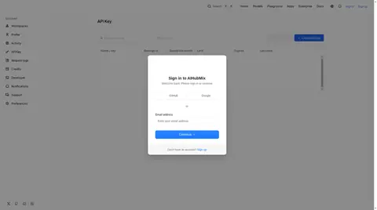](img/full/ah-auth-signin.webp) [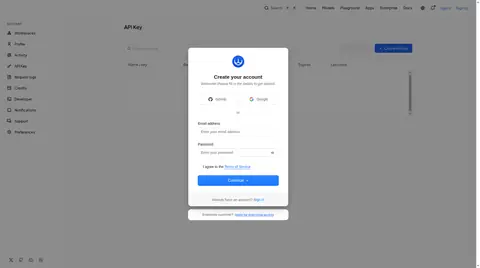](img/full/ah-auth-signup.webp) [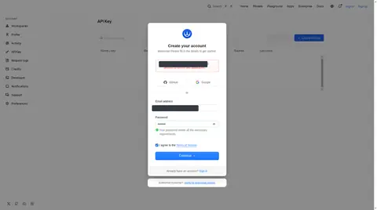](img/full/ah-auth-signup-blocked.webp)

#### 首页落地
- **AIHubMix**：一句话定位 + 三个卖点 + 渠道、排行、生态等证据；730+ 与模型广场的 954 不一致
- **kie.ai**：Hero + 三条承诺（失败不扣费、积分永不过期、$0 月费）+ 官方价对比表 + 精选模型 + 16 条 FAQ
- **OpenRouter**：企业页按研发、财务、安全、采购四类角色分别讲卖点 [OR2](https://openrouter.ai/enterprise)
- **更优**：kie.ai
- **我们取法**：首屏写定位和三条承诺，接着放 6～10 个热门模型的「我们价 vs 官方价」，再放 FAQ；不放点不开的状态标签

kie.ai 首页的「官方价对比表」直接回答「为什么用你」，FAQ 把失败计费、积分过期、发票、限流讲在前面；AIHubMix 首页更像品牌页。中转站以价格竞争为主，首页照 kie.ai 的结构，但数字要来自同一数据源。

 [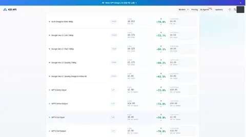](img/full/ki-p-home-price.webp) [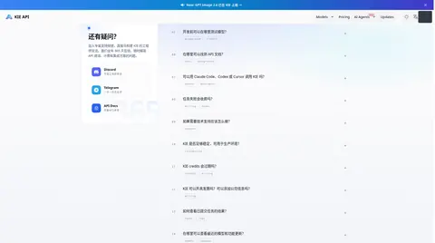](img/full/ki-p-home-faq.webp) 

#### 模型广场
- **AIHubMix**：左侧多维筛选，卡片显示输入/输出价、上下文、TTFT、吞吐和折扣胶囊；筛选区占掉不少首屏高度
- **kie.ai**：厂商 + 用途两组标签，筛选写进 URL（/market/lip-sync）；卡片是深色封面，但不显示价格
- **OpenRouter**：按模态分页签，左侧筛选；每行给出单价、上下文和累计 tokens 用量 [OR9](https://openrouter.ai/models)
- **更优**：AIHubMix（卡片）+ kie.ai（URL 筛选）
- **我们取法**：卡片信息照 AIHubMix；筛选做成可分享的 URL；筛选区默认收起

AIHubMix 卡片信息最全（价格、上下文、速度、折扣），适合做对比；kie.ai 的用途标签（如 Lip Sync）对多媒体用户更直观，筛选结果有独立 URL，利于 SEO 和分享；OpenRouter 用列表行展示，信息密度最高。

[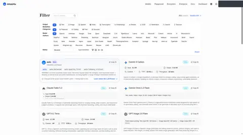](img/full/ah-p-models.webp) [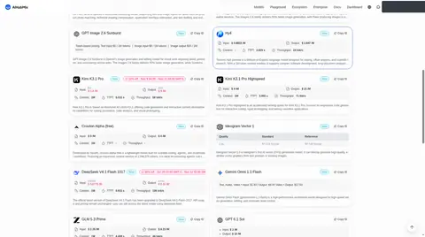](img/full/ah-p-models-2.webp)   [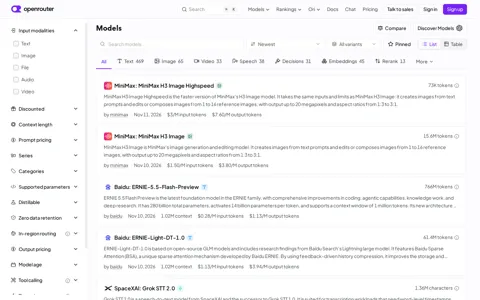](img/full/or-models.webp)

#### 模型详情
- **AIHubMix**：锚点导航：Pricing → Specs → Providers（同模型多渠道并排）→ Performance → Usage → Try → FAQ
- **kie.ai**：页签：Playground / Examples / Similar / README / API，表单与 JSON 可切换，一页内可以试跑
- **OpenRouter**：Providers 表并排列出各渠道价格、延迟、吞吐、Uptime，可切 P50～P99；还展示「客户实际支付均价」[OR8](https://openrouter.ai/anthropic/claude-sonnet-4.6)
- **更优**：文本看 OpenRouter / AIHubMix，多媒体看 kie.ai
- **我们取法**：文本模型：价格 + 渠道表 + 代码；多媒体模型：参数表单 + 价格网格 + 试跑

文本模型的关键问题是「多少钱、走哪个渠道、稳不稳」，AIHubMix 和 OpenRouter 的渠道表正好回答；多媒体的关键问题是「参数怎么填、一条多少钱」，kie.ai 的表单 + 价格网格 + 试跑更合适。两种模板都要。

[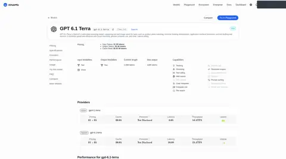](img/full/ah-p-model-detail.webp)  [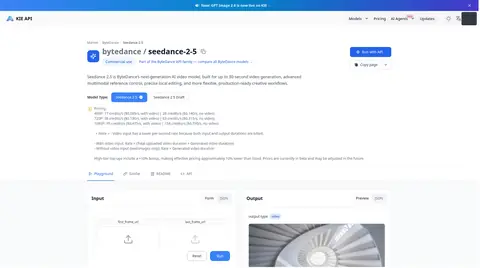](img/full/ki-m-seedance.webp) [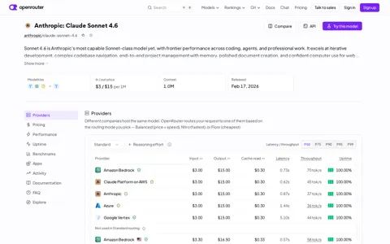](img/full/or-model.webp) [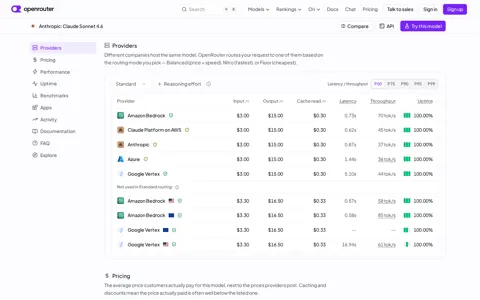](img/full/or-model-providers.webp)

#### 价格页
- **AIHubMix**：没有独立价格总表，价格分散在卡片和详情页；图像按「质量 × 尺寸」矩阵，视频按秒
- **kie.ai**：/pricing 每行给积分、我们价、官方价（或 Fal 价）、折扣；按模型分组；页签计数按价格行算（654）
- **OpenRouter**：套餐页说明推理按渠道标价、充值时收平台费；同一模型按渠道分别标价 [OR1](https://openrouter.ai/pricing) [OR7](https://openrouter.ai/api/v1/models/anthropic/claude-sonnet-4.6/endpoints)
- **更优**：kie.ai
- **我们取法**：照 kie.ai 做，人民币直标；计数按模型算；对比依据（官方价或渠道价）写在表头

kie.ai 价格表是本次看到的最适合转售站的形式。要改的地方：按模型计数、人民币直标、长段价格说明改成表格。AIHubMix 的「质量 × 尺寸」矩阵适合图像模型。

[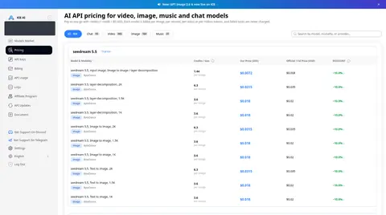](img/full/ki-c-pricing.webp) [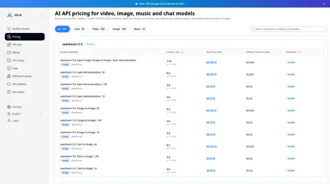](img/full/ki-p-pricing-pub.webp) [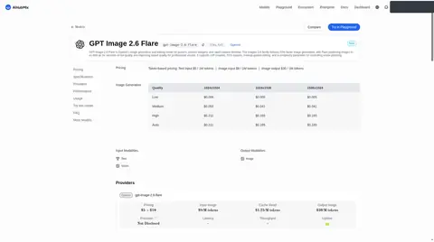](img/full/ah-p-model-image.webp) [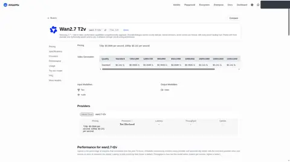](img/full/ah-p-model-video.webp) [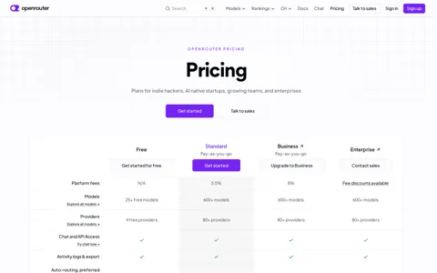](img/full/or-pricing.webp)

#### 充值计费
- **AIHubMix**：$15 / $50 / $100 + 自定义；手续费写明由平台承担；兑换码、USDC、自动充值（每次最少 $25）
- **kie.ai**：4 档套餐，大额档 SAVE 5% / 10%（换算核对一致）；自动充值最多每 10 分钟扣一次；积分永不过期
- **OpenRouter**：Standard 收 5.5%、Business 收 8% 平台费；24 小时内可在页面上自助退未用额度；支持银行卡、支付宝、USDC [OR1](https://openrouter.ai/pricing) [OR3](https://openrouter.ai/docs/faq)
- **更优**：AIHubMix + kie.ai
- **我们取法**：预设金额 + 赠送角标 + 手续费说明 + 兑换码；弹窗底部显示当前充值账户；退款规则写清楚

AIHubMix 的弹窗写明手续费由平台承担、底部显示当前账户，能防止充错号；kie.ai 把限流规则写在充值页，套餐角标和实际赠送比例一致。OpenRouter 允许 24 小时内在页面上自助退款 [OR3](https://openrouter.ai/docs/faq)，规则清楚，可以参考。

[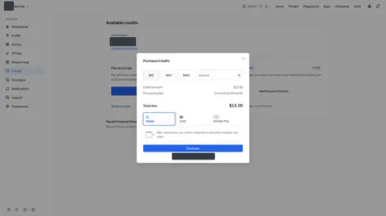](img/full/ah-c-purchase.webp) [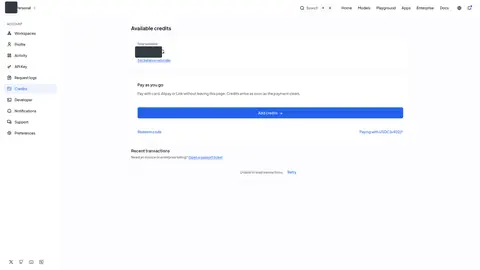](img/full/ah-c-credits.webp) [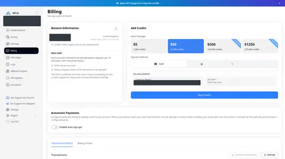](img/full/ki-c-billing.webp)

#### API Key
- **AIHubMix**：创建抽屉：工作区、额度、过期、模型、IP、结构化输出修复、模型映射（≤5）、失败回退（≤3）
- **kie.ai**：创建弹窗：有效期 1/7/30/90 天/永久；IP 默认推荐白名单，可填「最近调用的 IP / 检测我的服务器」；列表有 Safe-Spend 列
- **OpenRouter**：Key 安全页按风险标出无限额、无过期的 Key，可批量设限、停用；Key 花费到 80% / 100% 时提醒；有管理 Key 和轮换指南 [OR24](https://openrouter.ai/docs/guides/overview/auth/security-settings) [OR33](https://openrouter.ai/docs/guides/features/notifications) [OR55](https://openrouter.ai/docs/cookbook/administration/api-key-rotation)
- **更优**：kie.ai（表单）+ AIHubMix（字段）+ OpenRouter（风险视图）
- **我们取法**：P0 做表单和安全默认值；P1 做风险列表；P2 做映射和回退

kie.ai 的安全默认值（推荐 IP 白名单、未设限的 Key 加警示图标）最值得照抄；AIHubMix 的抽屉说明了 Key 可以承载哪些策略；OpenRouter 的 Key 安全页把风险集中到一处，并能批量处理 [OR24](https://openrouter.ai/docs/guides/overview/auth/security-settings)。

[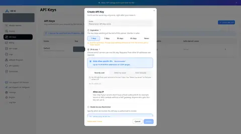](img/full/ki-c-key-create.webp) [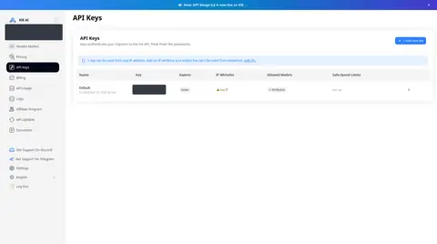](img/full/ki-c-keys.webp) [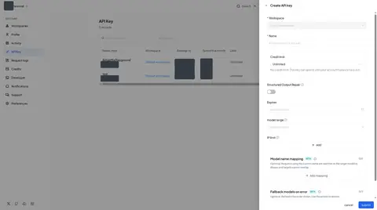](img/full/ah-c-key-create.webp)

#### 请求 / 任务日志
- **AIHubMix**：列：时间、模型、渠道、App、输入、输出、费用、Finish reason；可设置列；Key 页可导出
- **kie.ai**：按 Task ID、状态、日期筛选；单条或批量重发回调；保留期写在页面顶部（媒体 14 天、日志 2 个月）
- **OpenRouter**：生成详情：渠道、费用、tokens、Finish reason、延迟、数据区域、回退过程；逐次上游尝试的瀑布图；费用拆分 [OR31](https://openrouter.ai/docs/guides/features/logs)
- **更优**：OpenRouter（深度）；AIHubMix + kie.ai（首发范围）
- **我们取法**：P0：AIHubMix 的列 + kie.ai 的 Task ID 和保留期 + trace id；P2：回退过程和上游尝试明细

中转站的扣费纠纷要靠日志解决。首发要有：每条扣费、渠道分组、Finish reason、trace id、Task ID 搜索、CSV 导出。OpenRouter 的生成详情还会列出每次上游尝试和费用拆分（缓存读折扣、联网搜索等）[OR31](https://openrouter.ai/docs/guides/features/logs)，可作为 P2 目标。

[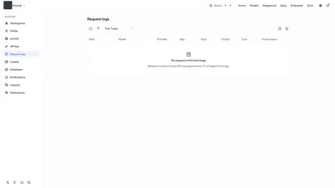](img/full/ah-c-logs.webp) [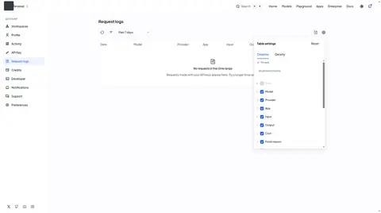](img/full/ah-c-logs-columns.webp) [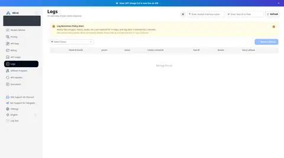](img/full/ki-c-logs.webp)

#### 用量分析
- **AIHubMix**：KPI（花费、请求数、tokens、缓存命中率、混合单价）+ 7 张图；可选时区
- **kie.ai**：日期范围、导出；按接口、按 Key 两个表
- **OpenRouter**：Overview / Trends / Explore（自定义分组）/ Guardrails 四个页签，筛选写进 URL；导出 CSV / PDF [OR30](https://openrouter.ai/docs/guides/features/activity) [OR50](https://openrouter.ai/docs/cookbook/administration/activity-export)
- **更优**：AIHubMix（首发）/ OpenRouter（远期）
- **我们取法**：先做 KPI + 按 Key / 模型的花费图；时区默认 Asia/Shanghai

AIHubMix 的「缓存命中率」和「混合单价」两项指标能直接回答「钱花得值不值」；OpenRouter 的 Activity 有同样的 KPI，并多了自定义分组和导出 [OR30](https://openrouter.ai/docs/guides/features/activity)。

[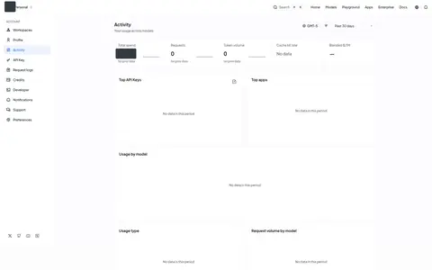](img/full/ah-c-activity.webp) [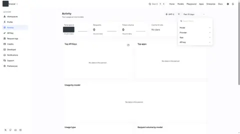](img/full/ah-c-activity-filter.webp) [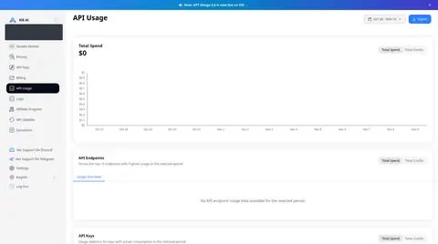](img/full/ki-c-usage.webp)

#### 通知
- **AIHubMix**：低余额（默认 $1）、新模型、下线、调价、产品更新、安全告警；可推送到 Inbox、邮件、Webhook
- **kie.ai**：邮件订阅开关；VIP 频道宣传低余额提醒
- **OpenRouter**：低余额（默认 $100）、模型下线、降价日报（列出新旧价格）、Key 限额 80% / 100%，可推送到邮件、Slack、自定义 Webhook [OR33](https://openrouter.ai/docs/guides/features/notifications)
- **更优**：AIHubMix + OpenRouter
- **我们取法**：P0 低余额；P1 下线 / 调价 / Key 限额 + 飞书、企微、钉钉 Webhook

AIHubMix 的规则 + 抽屉 + 目的地结构清楚；OpenRouter 的两个细节值得照抄：余额要明显回升到阈值以上才会再次提醒，避免在阈值附近反复刷屏；降价只对最近用过的模型发日报 [OR33](https://openrouter.ai/docs/guides/features/notifications)。

[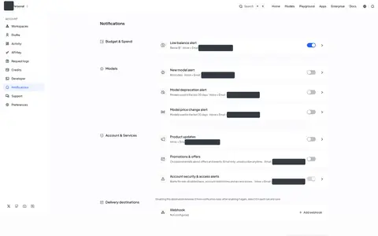](img/full/ah-c-notifications.webp) [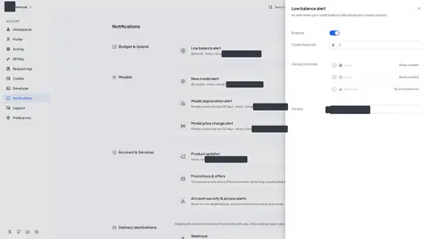](img/full/ah-c-notify-lowbalance.webp) [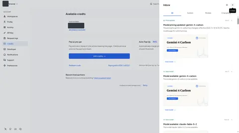](img/full/ah-c-inbox.webp)

#### 状态页
- **AIHubMix**：status.aihubmix.com 按协议拆 5 个组件，90 天可用率（Gemini 兼容接口 92.91% 也照样公开）
- **kie.ai**：没有找到公开状态页；首页「平台实时状态」只是一个文字标签
- **OpenRouter**：status.openrouter.ai 按 API 端点拆组件，90 天条形图，可订阅；模型页另有按渠道的 Uptime [OR12](https://status.openrouter.ai/) [OR8](https://openrouter.ai/anthropic/claude-sonnet-4.6)
- **更优**：AIHubMix + OpenRouter
- **我们取法**：P1 照 AIHubMix 拆组件；P2 在模型页加按渠道的可用率

两家状态页都按协议或端点拆组件，并保留 90 天历史。AIHubMix 公开了不好看的 92.91%，反而显得可信。kie.ai 没有状态页，是 B2B 客户评估时的扣分项。

[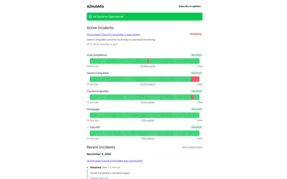](img/full/ah-s-status.webp) [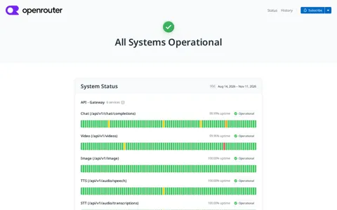](img/full/or-status.webp)

#### 模型上新 / 下线
- **AIHubMix**：Model Retirements 页：计划下线 12 个、已下线 120 个，附替代模型；下线模型返回 404 model_retired
- **kie.ai**：控制台 API Updates 与公开 Changelog 共用一份数据，每条带文档和试用链接
- **OpenRouter**：下线提醒只发给最近用过该模型的用户；`~latest` 别名自动跟随新版；API 变更日志有 RSS [OR33](https://openrouter.ai/docs/guides/features/notifications) [OR20](https://openrouter.ai/docs/guides/features/latest-resolution) [OR58](https://openrouter.ai/docs/api_reference/versioning)
- **更优**：AIHubMix
- **我们取法**：公告中心 = 上新 + 调价 + 下线日历；下线模型返回明确的错误码

模型变动是中转站客服压力的主要来源。AIHubMix 的下线日历（公告日、下线日、替代模型）加上明确的错误码，基本能消除「这个模型怎么突然不能用了」类咨询。

[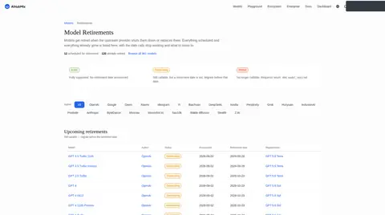](img/full/ah-p-retirements.webp) [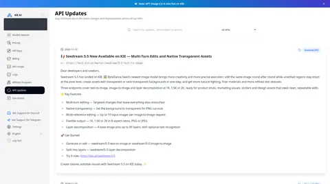](img/full/ki-c-api-updates.webp) [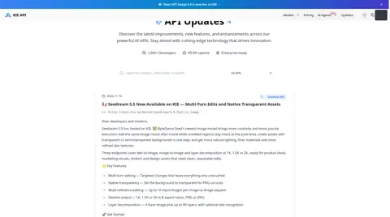](img/full/ki-p-changelog.webp)

#### 工单客服
- **AIHubMix**：先给常见问题卡片（401 / 403 / 429 等），再开工单（含 Trace ID、附件）
- **kie.ai**：只有私密 Discord VIP 频道；Telegram 入口点不开；邮件写明「不是首选」
- **OpenRouter**：套餐页写明 Standard / Business 为邮件支持，Enterprise 配专属支持团队 [OR1](https://openrouter.ai/pricing)
- **更优**：AIHubMix
- **我们取法**：FAQ 卡片 → 工单（带 trace id）→ 付费客户专属飞书或企微群

AIHubMix 先让用户自助排查，再开工单，工单里的 Trace ID 能直接定位请求；kie.ai 的「付费客户私密频道」对国内客户可改成飞书或企业微信专属群。

[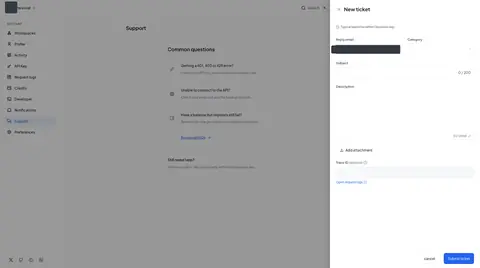](img/full/ah-c-support.webp) [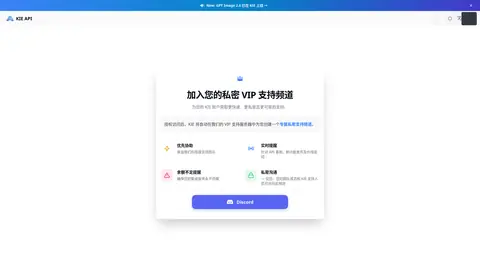](img/full/ki-p-vip.webp)

#### 文档
- **AIHubMix**：中英双语；Quick Start 同时给备用域名；三栏 API 参考，可 Try it
- **kie.ai**：Getting Started (Important) 一页 11 节，把限流、保留期、「200 只代表任务创建成功」等坑都提前讲
- **OpenRouter**：错误码分 400 / 401 / 402 / 403 / 408 / 429 / 502 / 503，带 Retry-After；版本与弃用规则成文；每页有 .md 版本 [OR57](https://openrouter.ai/docs/api_reference/errors-and-debugging) [OR58](https://openrouter.ai/docs/api_reference/versioning) [OR60](https://openrouter.ai/docs/llms.txt)
- **更优**：kie.ai（必读页）+ OpenRouter（错误码）
- **我们取法**：P0：接入必读 + 错误码页；P1：多协议 API 参考

kie.ai 的「Important」必读页把上线前必须知道的事集中在一页，是新用户首次接入时最该看的页面；AIHubMix 的 Quick Start 第一屏就给备用域名，这对国内网络环境尤其重要。

[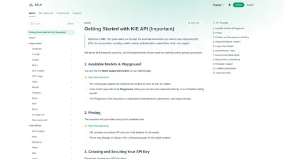](img/full/ki-d-home.webp) [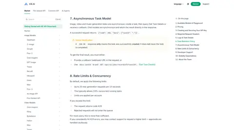](img/full/ki-d-rate.webp) [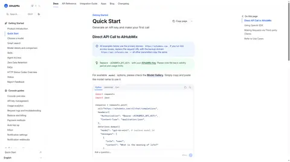](img/full/ah-d-quickstart.webp) [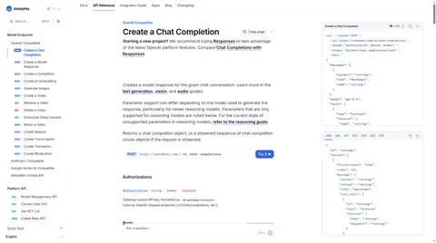](img/full/ah-d-apiref.webp)

#### SDK 与代理集成
- **AIHubMix**：llms.txt、agents.md、openapi.json；Developer 页用同一把 Management Key 驱动 MCP（12 个工具）、CLI、HTTP
- **kie.ai**：npx skills 一条命令装两个 skill；可以用 KIE 积分跑 Claude Code / Codex
- **OpenRouter**：官方 SDK（TS / Python / Go）；远程 MCP（OAuth 登录）；Claude Code、Codex、Cursor 等接入教程 [OR49](https://openrouter.ai/docs/guides/overview/mcp-server) [OR60](https://openrouter.ai/docs/llms.txt)
- **更优**：AIHubMix
- **我们取法**：P1：llms.txt + 常用工具的接入教程；P2：MCP / CLI

AIHubMix 把「让 AI 代理自己接入」做成了产品功能，每个工具都标明需要什么凭证、是否计费。成本最低的第一步是 llms.txt 和一页错误码文档。

[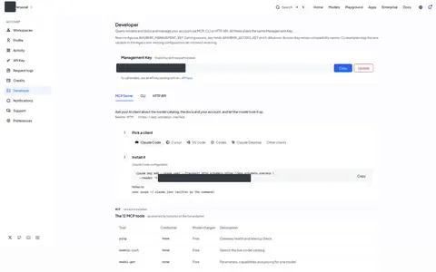](img/full/ah-c-developer-mcp.webp) [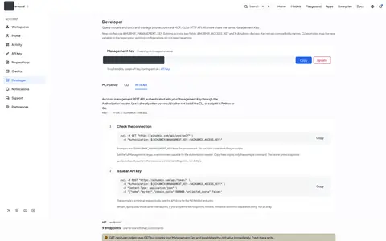](img/full/ah-c-developer-http.webp) [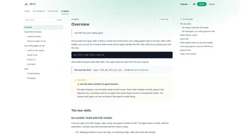](img/full/ki-d-agents.webp)

#### 路由与容灾
- **AIHubMix**：Key 级失败回退（BETA）；model="auto" 四种策略，评分表公开
- **kie.ai**：未见用户可配置的路由
- **OpenRouter**：渠道排序（价格 / 吞吐 / 延迟）、指定 / 排除 / 只用某些渠道、价格上限、数据政策过滤；模型回退数组；:floor / :nitro；Auto Router [OR13](https://openrouter.ai/docs/guides/routing/provider-selection) [OR14](https://openrouter.ai/docs/guides/routing/model-fallbacks) [OR19](https://openrouter.ai/docs/guides/routing/routers/auto-router)
- **更优**：OpenRouter
- **我们取法**：P2：把后台渠道路由变成用户可选的「经济 / 高速」模式，并在日志里显示实际走的渠道

AIHubMix 公开 auto 路由的评分表，让「auto」不再是黑盒；OpenRouter 的路由参数最全 [OR13](https://openrouter.ai/docs/guides/routing/provider-selection)。注意 OpenRouter 的一个提醒：`:free` 模型回退到付费模型时会按付费价格计费 [OR16](https://openrouter.ai/docs/guides/routing/model-variants/free)，你做回退时也要把这条写进文档。

[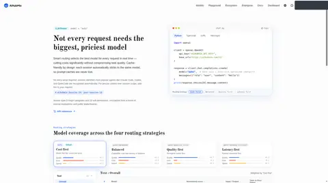](img/full/ah-p-router.webp) [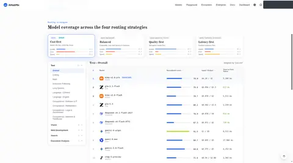](img/full/ah-p-router-table.webp) 

#### 多媒体异步任务
- **AIHubMix**：图像、视频走 /ai/v1，以异步任务返回
- **kie.ai**：统一 createTask + recordInfo；状态枚举；推荐回调，轮询要指数退避；HMAC 回调签名（不覆盖请求体）
- **OpenRouter**：视频生成走专用异步 API，支持 Webhook [OR46](https://openrouter.ai/docs/guides/overview/multimodal/video-generation)
- **更优**：kie.ai
- **我们取法**：照 kie.ai 统一接口，但签名要覆盖时间戳 + 原始请求体

kie.ai 用一个 createTask 和一个查询接口统一了几十个多媒体模型，再加上回调重发和保留期说明，排障路径很清楚。不要照抄的是 HTTP 200 包错误和签名不覆盖请求体。

  

#### 邀请返佣 / 增长
- **AIHubMix**：邀请链接藏在偏好设置里；生态页 + 开发者计划；企业销售表单
- **kie.ai**：15% 佣金（前 30 天）、45 天安全期、按支付指纹防作弊、每周结算；SEO 博客，文章页侧栏放模型卡
- **OpenRouter**：带上应用标识的请求可以出现在公开排行里 [OR48](https://openrouter.ai/docs/app-attribution) [OR10](https://openrouter.ai/rankings)
- **更优**：kie.ai
- **我们取法**：照 kie.ai 的规则，入口放到首页和顶栏；演示数据要整块置灰

kie.ai 的推广规则写得最具体（比例、周期、安全期、结算频率、防作弊方式）。AIHubMix 的生态页能告诉用户「在哪些工具里能用」，对中转站用户也很实用。

  

#### 企业与团队
- **AIHubMix**：工作区（个人最多 5 个）；代码里有组织、成员、审计路由；企业子站 + 销售表单
- **kie.ai**：Settings 页里用邮箱邀请成员，显示角色
- **OpenRouter**：组织统一出钱；工作区隔离 Key、路由和观测配置；按成员或 Key 设护栏和预算；SSO / SCIM [OR52](https://openrouter.ai/docs/cookbook/administration/organization-management) [OR37](https://openrouter.ai/docs/guides/features/workspaces) [OR36](https://openrouter.ai/docs/guides/features/guardrails) [OR47](https://openrouter.ai/docs/guides/features/sso)
- **更优**：OpenRouter（分层）/ AIHubMix（界面）
- **我们取法**：P1：企业账号 + 子账号 / 项目额度；P2：审计、SSO

AIHubMix 的「账户 → 工作区」面包屑切换，是界面上最轻的分层做法；OpenRouter 文档给出了预算如何归属的规则：成员自建的 Key 计入该成员的预算，新建 Key 不会重置成员计数 [OR39](https://openrouter.ai/docs/guides/best-practices/spend-controls)。做子账号额度时可以直接沿用。

   

#### 安全合规与隐私
- **AIHubMix**：7 份法务文件（含 ZDR 条款）；Payment Notice 承诺停服时退还余额
- **kie.ai**：隐私政策写「只收集邮箱、不用 cookies」，与手机号登录和 Google Analytics 不符
- **OpenRouter**：默认不存提示词和输出；私有日志需主动开启；可只路由到不留存数据的渠道；同意数据使用可得 1% 折扣 [OR41](https://openrouter.ai/docs/guides/privacy/data-collection) [OR40](https://openrouter.ai/docs/guides/features/zdr) [OR13](https://openrouter.ai/docs/guides/routing/provider-selection)
- **更优**：OpenRouter
- **我们取法**：P0：政策与实际一致；P1：数据不留存承诺 + 可选私有日志（写明保留期）

AIHubMix 的 Payment Notice 承诺停服时退还剩余余额（扣除相关费用），对预充值模式很重要；kie.ai 的隐私政策与实际做法不符，是反例。OpenRouter 默认不存提示词和输出，私有日志需要主动开启 [OR41](https://openrouter.ai/docs/guides/privacy/data-collection)；开启后至少保留 3 个月 [OR32](https://openrouter.ai/docs/guides/features/input-output-logging)。

  

## 三、优点精选与弊端规避
下面先把三站的优点按主题合成一份清单（每条注明来自哪个站、我们怎么落地），再列出要避开的坑。AIHubMix、kie.ai 的内容出自前两份调研；OpenRouter 的条目带来源编号。
### 优点精选（合并清单）
#### 价格与透明
| # | 优点 | 来自 | 我们怎么落地 | 优先级 |
|---|---|---|---|---|
| 1 | 每行「我们价 + 官方价 + 折扣 %」，对比依据写在表头 | kie.ai | 价格总表与模型卡片都显示；人民币直标 | **P0** |
| 2 | 多媒体按「分辨率 × 时长 × 是否带参考输入」逐行标价，并写出计费公式 | kie.ai | 视频页写出公式，例如「（参考视频时长 + 生成时长）× 单价」 | **P0** |
| 3 | 对话模型分别标出输入、输出、缓存读、缓存写四档价格 | kie.ai + OpenRouter | 模型详情页价格表固定四列 [OR7](https://openrouter.ai/api/v1/models/anthropic/claude-sonnet-4.6/endpoints) | **P0** |
| 4 | 限时折扣胶囊 + 起止日期 + 划掉的原价 | AIHubMix | 活动价自动到期；到期前在公告中心提醒 | **P1** |
| 5 | 同一模型多个渠道的价格、可用率并排列出 | AIHubMix + OpenRouter | 先按「分组」展示（官方渠道 / 经济渠道），P2 再公开每个渠道的可用率 [OR8](https://openrouter.ai/anthropic/claude-sonnet-4.6) | **P1** |
| 6 | 免费额度门槛公开成 JSON | AIHubMix | 试用额度、每日上限写进价格页和接口 | **P1** |

#### Key 与安全
| # | 优点 | 来自 | 我们怎么落地 | 优先级 |
|---|---|---|---|---|
| 7 | IP 白名单默认推荐，可一键填入「最近调用的 IP」 | kie.ai | 创建弹窗默认选中；列表里警示「任意 IP」 | **P0** |
| 8 | Key 本身就是策略：额度、过期、模型范围、IP | AIHubMix | 一个抽屉分段填完；BETA 功能标出数量上限 | **P0** |
| 9 | Key 风险总览：无限额、无过期、额度过高的 Key 集中列出，可批量处理 | OpenRouter | 安全中心页 [OR24](https://openrouter.ai/docs/guides/overview/auth/security-settings) | **P1** |
| 10 | Key 花费达到 80% / 100% 时提醒 Key 的创建者 | OpenRouter | 和低余额告警放在同一个通知中心 [OR33](https://openrouter.ai/docs/guides/features/notifications) | **P1** |

#### 计费规则与可核对
| # | 优点 | 来自 | 我们怎么落地 | 优先级 |
|---|---|---|---|---|
| 11 | 失败任务不扣费，并在首页、FAQ、价格页反复写明 | kie.ai | 写进条款，并在日志中标出「未计费」 | **P0** |
| 12 | 空回复和报错不计费，在用量页能看到这些请求扣费为 0 | OpenRouter | 计费引擎统一判定规则 [OR43](https://openrouter.ai/docs/guides/features/zero-completion-insurance) | **P0** |
| 13 | 回退时只按最终成功的模型计费，响应里返回实际使用的模型 | OpenRouter | 日志和响应都写明实际模型 [OR14](https://openrouter.ai/docs/guides/routing/model-fallbacks) | **P1** |
| 14 | 在途预扣：并发请求先按预估费用占用额度，防止余额被扣成负数 | OpenRouter | 计费引擎增加预扣，超出时返回带原因的 402 [OR56](https://openrouter.ai/docs/api_reference/limits) | **P0** |
| 15 | 限流规则写在充值页，保留期写在日志页顶部 | kie.ai | 规则写在用户实际会看的页面 | **P0** |
| 16 | 响应内直接返回 tokens 和费用，不用再调接口查 | OpenRouter | 在响应的 usage 字段里加 cost [OR53](https://openrouter.ai/docs/cookbook/administration/usage-accounting) | **P1** |

#### 可观测与可信
| # | 优点 | 来自 | 我们怎么落地 | 优先级 |
|---|---|---|---|---|
| 17 | 状态页按协议拆组件，低可用率也照样公开 | AIHubMix + OpenRouter | 用 Uptime Kuma 一类工具，按 OpenAI / Claude / Gemini 兼容和图像、视频拆分 [OR12](https://status.openrouter.ai/) | **P1** |
| 18 | 模型下线日历 + 替代模型 + 明确的错误码 | AIHubMix | 公告中心的一个页签；下线模型返回专用错误码 | **P1** |
| 19 | 用量分析展示缓存命中率和混合单价 | AIHubMix + OpenRouter | 用量页的 KPI 行 [OR30](https://openrouter.ai/docs/guides/features/activity) | **P1** |
| 20 | 错误带 trace id，工单里可以填 Trace ID | AIHubMix | 错误响应、日志、工单三处共用同一个 id | **P0** |

#### 开发者体验与增长
| # | 优点 | 来自 | 我们怎么落地 | 优先级 |
|---|---|---|---|---|
| 21 | 「接入必读」一页讲清 Base URL、限流、计费、保留期、支持时段 | kie.ai | 文档首页就是这一页 | **P0** |
| 22 | 模型页 = 价格 + 试用 + 说明 + API 四合一 | kie.ai | 多媒体模型详情模板 | **P1** |
| 23 | 统一异步任务接口 + 回调重发 | kie.ai | 一套任务状态枚举；日志里可以单条或批量重发回调 | **P0** |
| 24 | llms.txt、agents.md、每个文档页都有 .md 版本 | AIHubMix + OpenRouter | 文档站构建时自动生成 [OR60](https://openrouter.ai/docs/llms.txt) | **P1** |
| 25 | 推广规则具体：比例、周期、安全期、防作弊、周结算 | kie.ai | 推广页照抄规则结构 | **P1** |
| 26 | 生态页：在哪些工具里能用、接入难度如何 | AIHubMix | Cherry Studio、Cursor、Claude Code、Dify 等教程卡片 | **P1** |
| 27 | 新模型 / 调价消息一键跳到模型详情和试用 | AIHubMix + kie.ai | 站内信卡片带「去试用」「看文档」 | **P1** |
### 弊端规避清单
| # | 坑 | 出处 | 表现 | 我们怎么做 |
|---|---|---|---|---|
| 1 | 同一指标多种数字 | 三站都有 | AIHubMix 模型数 730+ / 954 / 961 / 500+；kie.ai 124 / 138 / 200+ / 654 行、开发者 120,000+ / 1,000+；OpenRouter 400+ / 600+ / API 469（全部模态 718）[OR5](https://openrouter.ai/docs/guides/overview/models) [OR1](https://openrouter.ai/pricing) [OR6](https://openrouter.ai/api/v1/models) | 所有对外数字由同一个配置或接口生成，并标明口径和更新时间 |
| 2 | 错误也返回 HTTP 200 | kie.ai | /api/v1/* 的错误码只放在响应体的 code 里 | 标准状态码；402 表示余额不足，429 表示限流并带 Retry-After |
| 3 | 回调签名不覆盖请求体 | kie.ai | 只签 taskId + 时间戳 | 签名覆盖「时间戳 + 原始请求体」，并设时间窗防重放 |
| 4 | 看起来能点的「实时状态」点不开 | kie.ai | 首页带绿点的文字标签 | 要么接真实状态页，要么不放 |
| 5 | 支持入口挂着却没有目标 | kie.ai | 侧栏、FAQ、About 都写 Telegram，但点不开 | 上线前对每个入口做链接巡检 |
| 6 | 隐私政策与实际做法不符 | kie.ai | 写「只收集邮箱、不用 cookies」，实际有手机号登录和 Google Analytics | 政策逐条对照登录方式、统计工具和日志保留期 |
| 7 | 中文路由下放英文内容 | kie.ai | /zh-CN/blog 下是英文文章 | 要么翻译，要么不放中文入口 |
| 8 | 价格说明写成一整段长文本 | kie.ai | GPT Image 2.6 页把多个子模型、多种价格挤在一段里 | 价格一律用表格 |
| 9 | 用积分计价，用户要自己换算 | kie.ai | 1 credit = $0.005 | 人民币直标；如果必须用额度单位，旁边同时显示人民币 |
| 10 | GET 请求带副作用 | AIHubMix | GET /api/user/token 会轮换 Management Key | 查询接口不改数据；写操作一律用 POST / PATCH / DELETE |
| 11 | 发票只能走工单 | AIHubMix | 需要人工处理，看不到进度 | 发票中心：在线申请，可查看进度和下载 |
| 12 | 拒绝注册却不说明原因 | AIHubMix | 我方域名邮箱被直接拒绝 | 说明原因（如域名受限），并给出申诉或人工渠道 |
| 13 | 筛选区占满首屏 | AIHubMix + kie.ai | /models 筛选区偏高；kie.ai 厂商和任务标签占约 4 行 | 默认收起，或做成一行横向标签 |
| 14 | 一个站同时用三四套字体 | AIHubMix | Plus Jakarta Sans、Old Standard TT、Inter 等 | 一套无衬线字体 + 一套等宽字体 |
| 15 | 演示数据像真实数据 | AIHubMix + kie.ai | 首页示意图里的余额；推广页 DEMO 金额 $1,450 | 演示区整块置灰，并标明「示例」 |
| 16 | 只支持海外登录方式 / 海外社群 | kie.ai | Google、Microsoft、Discord | 手机号 + 微信或邮箱；飞书 / 企业微信群 |
| 17 | 坦白「偶尔不稳定」，但没有补偿机制 | kie.ai | 文档第 10 节 | 坦白之外，再给 SLA 档位、故障补偿规则和事件复盘 |
| 18 | 免费模型回退到付费模型照常计费，用户可能没想到 | OpenRouter 文档中的提醒 | `:free` 放在回退数组里时，后面的付费模型按原价计费 [OR16](https://openrouter.ai/docs/guides/routing/model-variants/free) | 回退会改变计费时，在文档和日志里明确提示 |
| 19 | 额度可能过期 | OpenRouter | FAQ 写明保留对购买满一年未用的额度做过期处理 [OR3](https://openrouter.ai/docs/faq) | 如果不过期，就把「余额永不过期」写成卖点（kie.ai 的做法）；如果过期，提前通知 |

## 四、设计参考优先级
按「先抄哪一页」排序。**【必抄】** = 首发版本直接按这个页面的结构做；**【推荐】** = 第二阶段参考；**【可选】** = 有余力再做。每一行都写了「抄的时候要改什么」，因为两站的页面都有各自的问题。
### 页面优先级总表
| # | 我们的页面 | 参考 | 级别 | 理由 | 抄的时候要改什么 |
|---|---|---|---|---|---|
| 1 | 价格总表 | kie.ai /pricing | 【必抄】 | 我们价 / 官方价 / 折扣三列直接回答「为什么用你」；按模型分组，多媒体逐行列价 | 按模型计数（不是按价格行）；人民币直标；长段说明改成表格；表头写明对比依据 |
| 2 | API Key 创建弹窗 + 列表 | kie.ai /api-key | 【必抄】 | 安全默认值（推荐 IP 白名单）+ 一键填入最近调用的 IP + 列表警示图标 | 加入 AIHubMix 的额度和项目字段；「永不过期」也加警示 |
| 3 | 模型广场卡片 | AIHubMix /models | 【必抄】 | 卡片上直接给价格、上下文、速度和折扣，便于横向比较 | 筛选区默认收起；加上 kie.ai 的用途标签，筛选写进 URL |
| 4 | 请求日志 | AIHubMix Request logs | 【必抄】 | 列最全（渠道、App、Finish reason），可设置列 | 加 trace id、扣费明细、「未计费」标记；加导出 |
| 5 | 任务日志 | kie.ai /logs | 【必抄】 | Task ID 搜索、回调重发、保留期横幅，适合多媒体任务 | 合并进日志页，作为「任务」页签 |
| 6 | 充值页 / 充值弹窗 | AIHubMix Purchase + kie.ai Billing | 【必抄】 | AIHubMix：手续费说明、显示当前账户；kie.ai：套餐赠送角标、把限流写在充值页 | 人民币；加入对公转账、企业认证入口和发票说明 |
| 7 | 接入必读（文档首页） | kie.ai docs Getting Started | 【必抄】 | 上线前必须知道的事集中在一页 | 加备用域名（AIHubMix Quick Start 的做法）和错误码表（OpenRouter 的写法） |
| 8 | 首页 | kie.ai 首页 | 【必抄】 | 定位 + 三条承诺 + 官方价对比表 + FAQ，适合以价格竞争为主的站 | 去掉点不开的状态标签；所有数字来自同一数据源；自动滚动的卡片改成静态网格 |
| 9 | 工单与 FAQ | AIHubMix Support | 【必抄】 | 先自助排查，再开工单，工单里带 Trace ID | 另加「付费客户专属群」入口 |
| 10 | 模型详情（文本） | OpenRouter 模型页 + AIHubMix 模型详情 | 【推荐】 | 锚点导航 + 渠道并排表，一页讲清价格、渠道、稳定性和调用方式 | 首发版本只做价格 / 规格 / 代码；渠道可用率等有监控数据后再加 |
| 11 | 模型详情（多媒体） | kie.ai 模型页 | 【推荐】 | 参数表单 + 价格网格 + 试跑 + 代码一页完成 | 价格说明改成表格；试跑前先显示预计扣费 |
| 12 | 通知设置 | AIHubMix Notifications | 【推荐】 | 规则 + 配置抽屉 + 推送目的地，结构清楚 | 目的地换成飞书、企业微信、钉钉；加入 OpenRouter 的 Key 限额 80% / 100% 提醒 |
| 13 | 状态页 | AIHubMix status + OpenRouter status | 【推荐】 | 按协议或端点拆组件，90 天历史，可订阅 | 组件按「OpenAI 兼容 / Claude 兼容 / Gemini 兼容 / 图像 / 视频」拆分 |
| 14 | 公告中心（上新 / 调价 / 下线） | AIHubMix Retirements + kie.ai API Updates | 【推荐】 | 下线日历 + 替代模型；每条更新带「去试用」 | 三类合并成一个页面，用页签区分；同步推送到站内信 |
| 15 | 用量分析 | AIHubMix Activity | 【推荐】 | KPI 行 + 缓存命中率 + 混合单价 | 时区默认 Asia/Shanghai；首发只做 3～4 张图 |
| 16 | 项目 / 工作区 | AIHubMix Workspaces | 【推荐】 | 面包屑两级切换，不另起一套导航 | 用 new-api 的令牌分组包装成项目，先不做多成员 |
| 17 | 推广返佣 | kie.ai Affiliate | 【推荐】 | 规则写得最具体 | 演示数据整块置灰；入口放到顶栏 |
| 18 | 套餐 / 企业采购页 | OpenRouter Pricing + AIHubMix Enterprise | 【可选】 | 逐项对比的套餐表清楚说明各档差异；企业站单独讲合规和定制 | 按你的「个人 / 企业 / 代理商」三档写 |
| 19 | Playground | AIHubMix Playground | 【可选】 | 12 类能力，余额为 0 时直接弹出充值 | 先做文本和图像 |
| 20 | ⌘K 全局搜索 + 站内信 | AIHubMix ⌘K / Inbox | 【可选】 | 高级用户不用点菜单就能跳转；上新消息集中展示 | 先做「搜模型 + 搜页面」 |
| 21 | 模型对比 | AIHubMix Compare / OpenRouter Compare | 【可选】 | 选择写进 URL，方便分享，也利于 SEO；OpenRouter 还预置了旗舰、编程、低价、图像四组热门对比 [OR11](https://openrouter.ai/compare) | 有了足够的模型元数据之后再做 |
| 22 | 用量排行 | OpenRouter Rankings | 【可选】 | 用真实调用数据做内容和 SEO | 只发布匿名聚合数据，并在隐私政策里写明 |
| 23 | 开发者页（MCP / CLI / HTTP） | AIHubMix Developer | 【可选】 | 每个工具都标明需要的凭证和是否计费 | 先做只读的管理 API |
### 必抄页面截图对照
#### #1 价格总表
参考：kie.ai /pricing。改：按模型计数（不是按价格行）；人民币直标；长段说明改成表格；表头写明对比依据

 

#### #2 API Key 创建弹窗 + 列表
参考：kie.ai /api-key。改：加入 AIHubMix 的额度和项目字段；「永不过期」也加警示

 

#### #3 模型广场卡片
参考：AIHubMix /models。改：筛选区默认收起；加上 kie.ai 的用途标签，筛选写进 URL

  

#### #4 请求日志
参考：AIHubMix Request logs。改：加 trace id、扣费明细、「未计费」标记；加导出

 

#### #5 任务日志
参考：kie.ai /logs。改：合并进日志页，作为「任务」页签

#### #6 充值页 / 充值弹窗
参考：AIHubMix Purchase + kie.ai Billing。改：人民币；加入对公转账、企业认证入口和发票说明

 

#### #7 接入必读（文档首页）
参考：kie.ai docs Getting Started。改：加备用域名（AIHubMix Quick Start 的做法）和错误码表（OpenRouter 的写法）

 

#### #8 首页
参考：kie.ai 首页。改：去掉点不开的状态标签；所有数字来自同一数据源；自动滚动的卡片改成静态网格

  

#### #9 工单与 FAQ
参考：AIHubMix Support。改：另加「付费客户专属群」入口

### 推荐页面截图对照
#### #10 模型详情（文本）
参考：OpenRouter 模型页 + AIHubMix 模型详情。改：首发版本只做价格 / 规格 / 代码；渠道可用率等有监控数据后再加

  

#### #11 模型详情（多媒体）
参考：kie.ai 模型页。改：价格说明改成表格；试跑前先显示预计扣费

  

#### #12 通知设置
参考：AIHubMix Notifications。改：目的地换成飞书、企业微信、钉钉；加入 OpenRouter 的 Key 限额 80% / 100% 提醒

 

#### #13 状态页
参考：AIHubMix status + OpenRouter status。改：组件按「OpenAI 兼容 / Claude 兼容 / Gemini 兼容 / 图像 / 视频」拆分

 

#### #14 公告中心（上新 / 调价 / 下线）
参考：AIHubMix Retirements + kie.ai API Updates。改：三类合并成一个页面，用页签区分；同步推送到站内信

 

#### #15 用量分析
参考：AIHubMix Activity。改：时区默认 Asia/Shanghai；首发只做 3～4 张图

#### #16 项目 / 工作区
参考：AIHubMix Workspaces。改：用 new-api 的令牌分组包装成项目，先不做多成员

 

#### #17 推广返佣
参考：kie.ai Affiliate。改：演示数据整块置灰；入口放到顶栏

### 可选页面截图对照
#### #18 套餐 / 企业采购页
参考：OpenRouter Pricing + AIHubMix Enterprise。改：按你的「个人 / 企业 / 代理商」三档写

 

#### #19 Playground
参考：AIHubMix Playground。改：先做文本和图像

 

#### #20 ⌘K 全局搜索 + 站内信
参考：AIHubMix ⌘K / Inbox。改：先做「搜模型 + 搜页面」

 

#### #21 模型对比
参考：AIHubMix Compare / OpenRouter Compare。改：有了足够的模型元数据之后再做

 

#### #22 用量排行
参考：OpenRouter Rankings。改：只发布匿名聚合数据，并在隐私政策里写明

#### #23 开发者页（MCP / CLI / HTTP）
参考：AIHubMix Developer。改：先做只读的管理 API

### 视觉与交互规范
#### 视觉规范建议（合并两站优点）
| 项 | 建议 | 依据 |
|---|---|---|
| 字体 | 界面用系统中文字体（PingFang SC / 微软雅黑）+ 一套西文无衬线字体；价格、额度、Key 用等宽字体（如 Geist Mono / JetBrains Mono） | kie.ai 的价格表用等宽字体，列对得很齐；AIHubMix 字体太多 |
| 主色 | 一种偏深的蓝色作为主色（两站都用蓝：AIHubMix #2563eb、kie.ai #2b7fff）；折扣统一用绿色加向下箭头；警示用橙色；危险操作用红色 | 两站的共同选择，用户已经习惯 |
| 形状 | 圆角 8～12px，细线分隔，阴影很轻 | 两站相近 |
| 外壳 | 公开站用顶栏；控制台用左侧栏，账户级和项目级分两层，用面包屑切换；价格页和模型广场未登录也能看，用的是控制台外壳（kie.ai 的做法），看完价格不用换环境就能进控制台 | AIHubMix 的两层侧栏 + kie.ai 的外壳复用 |
| 密度 | 价格表、日志可以密；控制台首页和充值页留白多一些 | 两站都是这样 |
| 空态 | 每个空态都给下一步按钮（「创建第一个 Key」「试试更长的时间范围」） | AIHubMix 日志空态文案 |
| 状态色 | 成功、失败、未计费、回退四种状态，用固定颜色和图标表示 | 日志和任务页可读性 |
| 深色模式 | P2 | 两站都有，但不是必需 |

## 五、缺失功能与 OpenRouter 补充
分三部分：**A** 是 OpenRouter 有、两站没有或做得弱的能力；**B** 是其他成熟网关（LiteLLM、Portkey、Vercel AI Gateway）的补充思路，只读了文档目录或首页，单独标出；**C** 是站在国内 B2B 中转站角度、三站都没覆盖或容易被忽略的事项。每条都标了优先级 **P0** **P1** **P2**。
### A · OpenRouter 有、两站缺或弱
| 能力 | OpenRouter 的做法 | AIHubMix | kie.ai | 对我们 | 级别 |
|---|---|---|---|---|---|
| 空回复 / 报错不计费 | 没有输出 tokens 且 finish reason 为空，或 finish reason 是错误时，不扣模型费用；已执行的联网搜索等附加服务仍计费 [OR43](https://openrouter.ai/docs/guides/features/zero-completion-insurance) | 未见成文规则 | 「失败任务不扣费」（多媒体） | 写进条款，文本和多媒体统一判定；日志标记「未计费」 | **P0** |
| 在途预扣防透支 | 按输入 tokens + max_tokens 预估费用，请求进行中先占用额度；超出时返回 402，并在 metadata 里说明原因 [OR56](https://openrouter.ai/docs/api_reference/limits) | 未见 | 未见 | 中转站并发高，最容易出现负余额；计费引擎必须做 | **P0** |
| 标准错误码 + Retry-After | 400 / 401 / 402 / 403 / 408 / 429 / 502 / 503 分别对应明确含义，429 带 Retry-After；流式中途出错有专门格式 [OR57](https://openrouter.ai/docs/api_reference/errors-and-debugging) | 有 tid 和限流头 | 错误返回 HTTP 200 | 错误码页 + 中文原因 + trace id | **P0** |
| 响应内返回费用 | 每个响应都带 tokens、费用、推理 tokens 和缓存 tokens，不需要额外调用 [OR53](https://openrouter.ai/docs/cookbook/administration/usage-accounting) | 未见 | 任务结果里有 creditsConsumed | 在 usage 里加 cost 字段（人民币） | **P1** |
| 渠道路由偏好 | 按价格、吞吐或延迟排序；指定、排除、只用某些渠道；价格上限；吞吐、延迟门槛可按 P50～P99 设置 [OR13](https://openrouter.ai/docs/guides/routing/provider-selection) | 仅 Key 级回退（BETA） | 无 | 先给「经济 / 标准 / 高速」三档，对应你后台的渠道分组 | **P2** |
| 模型回退数组 | `models` 数组按顺序尝试，按最终成功的模型计费，响应里返回实际模型 [OR14](https://openrouter.ai/docs/guides/routing/model-fallbacks) | Key 级回退（≤3 个） | 无 | 请求参数 + Key 默认值两种方式 | **P2** |
| 变体后缀 | `:free`、`:floor`（最便宜）、`:nitro`（最快）、`:batch` 等后缀，各自在目录里单列价格和上下文；`:floor` 会让上游的 flex 档参与比价，`:nitro` 会让 priority 档参与比速 [OR15](https://openrouter.ai/docs/guides/routing/model-variants/overview) [OR44](https://openrouter.ai/docs/guides/features/service-tiers) | 无 | 无 | 用分组后缀表达渠道档位，比让用户记一堆模型名更清楚 | **P2** |
| `latest` 别名 | `~anthropic/claude-opus-latest` 自动指向该系列最新版本，响应里返回实际版本 [OR20](https://openrouter.ai/docs/guides/features/latest-resolution) | 无 | 无 | 降低模型升级时的客服量 | **P2** |
| 预设 Preset | 把模型、路由、系统提示词和参数存成命名配置，在请求里引用 [OR29](https://openrouter.ai/docs/guides/features/presets) | 无 | 无 | 适合企业客户统一配置 | **P2** |
| Prompt 缓存 + 粘性路由 | 缓存请求之后，后续请求尽量路由到同一渠道，提高命中率 [OR25](https://openrouter.ai/docs/guides/best-practices/prompt-caching) | 有 Session-Id 粘性 | 未见 | 渠道路由要考虑缓存命中；日志显示缓存读写 tokens | **P1** |
| 相同请求缓存 | 相同请求直接返回缓存结果且不计费，TTL 默认 300 秒，可设 1～86400 秒 [OR28](https://openrouter.ai/docs/guides/features/response-caching) | 无 | 无 | 适合评测、重复调用场景 | **P2** |
| 结构化输出 + JSON 修复 | 支持 JSON Schema 约束输出；Response Healing 插件修复格式错误的 JSON [OR26](https://openrouter.ai/docs/guides/features/structured-outputs) [OR27](https://openrouter.ai/docs/guides/features/plugins/response-healing) | Key 级「结构化输出修复」 | 无 | 先在文档说明哪些模型支持 | **P2** |
| Batch 批量接口 | 批量任务一般为同步价格的 50%，多数 24 小时内完成 [OR45](https://openrouter.ai/docs/guides/features/batch-api) | 无 | 无 | 上游有批量价时转售给评测、数据标注类客户 | **P2** |
| BYOK 自带上游 Key | 用户可以接入自己的上游 Key；每月 $25,000 列表价以内免平台费，超出部分收 5% [OR21](https://openrouter.ai/docs/guides/overview/auth/byok) [OR1](https://openrouter.ai/pricing) | 无 | 无 | 企业客户已有官方账号时的方案；对中转站属于可选 | **P2** |
| OAuth PKCE | 第三方应用引导用户登录授权，拿到用户自己的 Key，推理费用由用户自己承担 [OR22](https://openrouter.ai/docs/guides/overview/auth/oauth) | 无 | 无 | 给下游 AI 应用开发者用，是 B2B2C 的入口 | **P2** |
| 终端用户标识 | 请求带 `user` 参数，用于按终端用户隔离滥用和统计 [OR54](https://openrouter.ai/docs/cookbook/administration/user-tracking) | 有 App 维度 | 无 | 让转售客户能按他们的用户对账 | **P1** |
| 护栏与多层预算 | 工作区预算（日 / 周 / 月 / 累计）+ 成员或 Key 护栏（限额、模型和渠道白名单、数据政策）[OR38](https://openrouter.ai/docs/guides/features/workspaces/workspace-budgets) [OR36](https://openrouter.ai/docs/guides/features/guardrails) [OR39](https://openrouter.ai/docs/guides/best-practices/spend-controls) | 有工作区，未见预算 | 有 Key 花费上限 | 子账号和项目额度的规则可以照 OpenRouter 设计 | **P1** |
| Key 安全中心 | 风险列（无限额 / 无过期 / 额度过高）、批量设限或停用；IP 白名单可按工作区生效 [OR24](https://openrouter.ai/docs/guides/overview/auth/security-settings) | 有 IP 限制 | 有 IP 白名单 | 安全中心页 | **P1** |
| 管理 Key 与轮换 | 管理 Key 只用于管理操作，建议设置过期时间；有零停机轮换指南；写操作每天有次数上限 [OR23](https://openrouter.ai/docs/guides/overview/auth/management-api-keys) [OR55](https://openrouter.ai/docs/cookbook/administration/api-key-rotation) [OR56](https://openrouter.ai/docs/api_reference/limits) | Management Key（GET 会轮换） | 无 | 先做只读接口 | **P2** |
| 降价 / 下线通知 | 只给最近用过的模型发提醒；降价按日汇总，列出新旧价格 [OR33](https://openrouter.ai/docs/guides/features/notifications) | 有新模型、下线、调价规则 | 无 | 通知中心 | **P1** |
| 观测数据外送 | Broadcast 把每个请求的 trace 推到 Langfuse、Datadog、S3 或自定义 Webhook（OTLP 格式）[OR34](https://openrouter.ai/docs/guides/features/broadcast) [OR35](https://openrouter.ai/docs/guides/features/broadcast/webhook) | 无 | 无 | 企业客户的需求，先做 Webhook | **P2** |
| 数据政策过滤 | 可以只路由到不留存数据的渠道，或排除可能用数据训练的渠道；默认不存提示词和输出 [OR40](https://openrouter.ai/docs/guides/features/zdr) [OR42](https://openrouter.ai/docs/guides/privacy/provider-logging) [OR41](https://openrouter.ai/docs/guides/privacy/data-collection) | 有 ZDR 条款 | 无 | 在模型详情里标出每个渠道的数据政策 | **P1** |
| 用量导出 | Activity 可导出 CSV / PDF，可按模型、Key、成员分组 [OR50](https://openrouter.ai/docs/cookbook/administration/activity-export) | Key 页可导出 | 用量页可导出 | 月度对账单的基础 | **P0** |
| 公开排行与应用归因 | 按真实 tokens 用量公开排行，数据以 CC BY 4.0 开放；带上应用标识即可上榜 [OR10](https://openrouter.ai/rankings) [OR48](https://openrouter.ai/docs/app-attribution) | 有排行模块 | 无 | 内容和 SEO 手段，P2 | **P2** |
| 模型目录 API + RSS | Models API 可按模态过滤，新模型有 RSS [OR5](https://openrouter.ai/docs/guides/overview/models) | 有 llms.txt、feed.json | 有 sitemap | 公开模型目录 JSON | **P1** |
| 区域路由 / 数据驻留 | 区域端点（美国 / 欧盟）单独标价，模型页可见 [OR8](https://openrouter.ai/anthropic/claude-sonnet-4.6) [OR1](https://openrouter.ai/pricing) | 无 | 无 | 国内可对应「境内节点 / 境外节点」 | **P2** |
| 企业身份 | SSO（Okta、Entra ID、Google Workspace、SAML），自助验证域名；SCIM 同步 [OR47](https://openrouter.ai/docs/guides/features/sso) | 未见 | 无 | 大客户出现后再做 | **P2** |
| SLA 与合规 | 企业版有合同 SLA；企业页写 SOC 2 Type II、DPA [OR1](https://openrouter.ai/pricing) [OR2](https://openrouter.ai/enterprise) | 宣称 99.9% | 宣称 99.9% | 先写清服务等级和补偿规则 | **P1** |

  

### B · 其他成熟网关的补充思路（仅读文档目录或首页，标注来源）
| 思路 | 出处 | 对我们 | 级别 |
|---|---|---|---|
| 每个 Key 可设多个预算时间窗（例如 7 天 $50 + 24 小时 $5），且 Key 的预算不能超过创建者自己的预算 | LiteLLM Virtual Keys [X1](https://docs.litellm.ai/docs/proxy/virtual_keys) | 子账号额度分配时防止下级额度大于上级 | **P1** |
| 团队软预算告警、临时提额（带到期时间）、预算重置时间和时区可配置 | LiteLLM Budgets [X2](https://docs.litellm.ai/docs/proxy/users) | 企业客户临时冲量时不用改正式额度 | **P2** |
| 熔断、自动重试、负载均衡、金丝雀测试、语义缓存 | Portkey 文档目录 [X3](https://portkey.ai/docs/product/ai-gateway) | 渠道健康度差时自动熔断；新渠道先放小流量 | **P1**（熔断）/ **P2** |
| 预算超限后，对该范围内的所有请求返回 HTTP 402，包括 BYOK 请求 | Vercel AI Gateway [X4](https://vercel.com/docs/ai-gateway) | 超预算的错误码和 OpenRouter 一致，用 402 | **P0** |
### C · 遗漏分析：国内 B2B 中转站容易漏掉的事
| 事项 | 为什么重要 | 三站现状 | 建议 | 级别 |
|---|---|---|---|---|
| 实名 / 企业认证 | 国内平台常见做法是先实名再充值、开票；企业认证决定账号归属和能开的发票类型 | 三站都没有。国内参考：硅基流动要求实名后才能充值和开票，企业可以通过法人人脸识别或对公打款认证 [X5](https://docs.siliconflow.cn/cn/faqs/authentication) | 个人和企业两种认证；账号归属以认证主体为准 | **P0** |
| 增值税发票 | B2B 客户的硬需求；没有发票，企业很难走报销和采购流程 | AIHubMix 走工单；kie.ai 手动生成；OpenRouter 在 Stripe 发票上加税号 [OR51](https://openrouter.ai/docs/cookbook/administration/tax-id)。硅基流动只对已消费金额开票，企业认证可开专票 [X7](https://docs.siliconflow.cn/cn/faqs/invoice) | 发票中心：按已消费金额申请，专票和普票，查看进度、下载 | **P0** |
| 对公转账充值 | 企业付款通常走对公账户 | 三站都没有 | 先下单再转账，打款账户名须与认证主体一致，到账后自动入账 | **P0** |
| 合同、对账单、预付协议 | 采购流程需要；也是续费的依据 | OpenRouter 企业版有合同和发票付款 [OR2](https://openrouter.ai/enterprise) | 月度对账单（PDF / Excel）自动生成；合同模板 | **P1** |
| 合规与备案 | 面向国内提供生成式 AI 服务、转售境外模型都涉及监管要求（具体义务需律师确认，本报告未核实） | 三站都在境外，不适用 | 上线前咨询律师；写清主体、服务范围和内容安全措施 | **P0**（咨询） |
| 内容安全 | 国内平台普遍对提示词和输出做安全审核（例如硅基流动的个人信息收集清单把「内容安全与风控」列为收集提示词和输出的用途之一 [X6](https://docs.siliconflow.cn/docs/legals/personal-information-collection-list)） | OpenRouter 有护栏，并对 CSAM 做筛查 [OR41](https://openrouter.ai/docs/guides/privacy/data-collection) | 至少做关键词和接口级审核，并在条款中写明 | **P0** |
| 数据不留存选项 | 企业客户会问：提示词存不存、存多久、谁能看 | OpenRouter 默认不存，私有日志需主动开启 [OR41](https://openrouter.ai/docs/guides/privacy/data-collection) | 默认只存元数据；内容日志可选，并写明保留期 | **P1** |
| 人民币定价与汇率 | 上游多以美元计价，汇率波动会影响毛利 | 三站都是美元 | 人民币标价；说明调价机制（例如汇率变动超过一定幅度时调整，提前通知） | **P0** |
| 价格变动通知与价格历史 | 转售客户要向他们的客户报价 | OpenRouter 有降价日报 [OR33](https://openrouter.ai/docs/guides/features/notifications)；AIHubMix 有调价通知 | 调价提前 N 天通知；每个模型显示价格历史 | **P1** |
| 渠道真实性（是否掺水、降级） | 中转站行业的核心信任问题：用户担心「标的是 A 模型，实际给的是更便宜的模型」 | OpenRouter 模型页公开每个渠道，端点数据带量化精度字段，请求时可按量化精度过滤 [OR8](https://openrouter.ai/anthropic/claude-sonnet-4.6) [OR7](https://openrouter.ai/api/v1/models/anthropic/claude-sonnet-4.6/endpoints) [OR13](https://openrouter.ai/docs/guides/routing/provider-selection)；AIHubMix 公开渠道 | 渠道分组写明来源类型（官方 / 云厂商 / 其他）；日志显示实际模型名；定期公开抽检方法 | **P1** |
| 渠道健康度 | 决定可用率和路由质量 | OpenRouter 实时追踪响应时间、错误率和可用性，并据此路由 [OR59](https://openrouter.ai/docs/guides/best-practices/uptime-optimization) | 内部按 5 分钟窗口统计成功率、首字时间和吞吐；对外先公开汇总结果 | **P0**（内部）/ **P1**（公开） |
| 风控 | Key 泄露被盗刷、支付欺诈、批量注册薅羊毛 | kie.ai 推广计划用支付指纹防作弊；OpenRouter 对管理接口按 IP 限频 [OR56](https://openrouter.ai/docs/api_reference/limits) | Key 异常用量告警和自动冻结；新账号设充值和并发上限；推广设安全期 | **P0** |
| 并发与提额 | 企业客户要知道上限，以及怎么提额 | kie.ai 写明每 10 秒 20 个请求；OpenRouter 付费请求的限流直接沿用上游 [OR1](https://openrouter.ai/pricing) | 限流档位写在充值页；提供自助申请提额 | **P1** |
| 子账号与额度分配 | 企业内部分部门、分项目用；转售客户要分给他们的客户 | OpenRouter 有成员、Key 两级预算 [OR39](https://openrouter.ai/docs/guides/best-practices/spend-controls) | 企业账号下设子账号和项目，各自限额；下级额度不能超过上级 | **P1** |
| 代理商 / 分销 / 白标 | 你做 B2B 转售，下游可能也是转售商 | 三站都没有 | 代理商后台：下级账号、加价规则、佣金、对账；P2 再考虑白标域名 | **P2** |
| 审计日志 | 企业客户要知道谁在什么时候创建、删除了 Key，改了额度 | AIHubMix 代码里有审计路由；OpenRouter 有 Key 审计指南（本次未读正文） | 记录登录、Key、额度、充值、成员变更 | **P1** |
| 业务 Webhook | 客户要把低余额、任务完成、调价等事件接进自己的系统 | AIHubMix 有通知 Webhook；kie.ai 有任务回调 | 统一事件 Webhook，带签名和重试 | **P1** |
| 备用域名与网络 | 国内网络环境下，单一域名风险大 | AIHubMix 在 Quick Start 给出备用域名 | 主域名 + 备用域名 + 状态页里写明切换方法 | **P0** |
| 客服时段与响应时效 | B2B 客户要知道「出事了多久能找到人」 | kie.ai 写明支持时段（北京时间 05:00 至次日 01:00） | 写明时段和响应时效；付费客户群有值班 | **P0** |
| 账户注销与余额退款 | 预充值模式的信任基础 | AIHubMix 注销要 15 个工作日审核，停服时退余额；OpenRouter 24 小时内可退 [OR3](https://openrouter.ai/docs/faq) | 写清退款条件、时效和手续费 | **P0** |
| 成本预估 | 多媒体单价复杂，用户想先知道一条大概多少钱 | kie.ai 给出「每张图约多少积分」的网格 | 模型页和 Playground 显示预计扣费 | **P1** |
| 模型对比工具 | 帮客户选型，也是 SEO 页面 | AIHubMix、OpenRouter 都有 Compare | P2 | **P2** |
| Playground | 试用到付费的转化路径最短 | AIHubMix 余额为 0 时直接弹充值 | P1 先做文本和图像 | **P1** |

## 六、建议策划
这一页把前面的结论落成可以开工的方案：目标站点地图、导航和数据模型、关键页面的线框描述、「功能 → 取自哪个站」映射表，以及上线后看哪些指标。后端按 new-api 类系统（令牌、分组、渠道、日志）估算，这一点是推断，需要光哥按实际系统确认。
### 目标站点地图
下图是建议的信息架构。每项下方的标签是优先级和主要参考来源。SVG 和 Mermaid 源码见 [sitemap.svg](sitemap.svg) 和 [sitemap.mmd](sitemap.mmd)。

#### 导航
- **公开站顶栏**：模型 · 价格 · 公告 · 文档 · 状态 · 企业 · 「控制台」按钮。价格页和模型广场未登录也能看，用控制台外壳（参考 kie.ai），看完价格可以直接注册，不用换环境。
- **控制台左栏 · 账户级**：总览 · 充值与账单 · 发票 · 通知 · 安全 · 团队与子账号 · 推广 · 工单 · 设置。
- **控制台左栏 · 项目级**（面包屑「企业名 / 项目名」切换，参考 AIHubMix）：项目总览 · API Key · 日志（请求 / 任务两个页签）· 用量 · 预算 · 设置。
- **全局**：⌘K 搜模型和页面（P1）；铃铛打开站内信，页签为 全部 / 系统 / 模型 / 公告（P1）。

#### 数据模型
`主体（个人 / 企业，带认证状态）→ 钱包（余额、预扣、发票额度）→ 项目（预算、默认分组）→ Key（额度、有效期、模型白名单、IP 白名单、默认路由档位）→ 请求 / 任务（trace id、渠道、扣费、状态）`。企业主体下可以挂多个子账号（成员），成员自建的 Key 计入该成员的额度，新建 Key 不会重置成员计数（这一条照 OpenRouter 的规则 [OR39](https://openrouter.ai/docs/guides/best-practices/spend-controls)）。代理商（P2）是一种特殊主体，可以给下级主体设加价规则。
### 关键页面线框描述
以下是 8 个关键页面的区块和来源，从上到下排列。

#### 控制台首页（参考：AIHubMix Profile KPI 卡 + Quick Start）
- 顶栏：面包屑「个人 / 默认项目」· ⌘K · 铃铛 · 头像
- 余额（人民币）+ 「充值」按钮 ｜ 本月花费 / 昨日花费 ｜ 认证状态：未认证时显示「完成企业认证可开专票」
- 两步上手：① 创建 Key（打开抽屉）② 复制代码（curl / Python / Node 页签，Base URL 和 Key 已填好） ｜ 公告：最近 3 条上新 / 调价 / 下线
- 最近 7 天花费柱状图（按模型） ｜ 低余额告警开关（默认开启，阈值可改）

#### 价格总表（参考：kie.ai /pricing）
- 页签：全部 / 对话 / 图像 / 视频 / 音频（计数按模型）· 搜索 · 「仅看折扣」开关
- 说明条：价格单位 ¥；官方价来源与更新时间；失败不扣费；限流规则链接
- 模型分组卡：模型名 + 厂商 + 用途标签 + 「详情 / 试用」 ｜ 逐行：模式 × 分辨率 / 时长 → 我们价（¥）· 官方价（划线）· 折扣（绿色）· 计费公式提示

#### 模型广场（参考：AIHubMix /models + kie.ai /market）
- 一行横向标签：模态 · 厂商 · 用途（点击后写进 URL）；「更多筛选」默认收起
- 卡片：模型名 · 厂商角标 · 输入 / 输出价 · 上下文 · 折扣胶囊 · New 标 · 复制模型 ID ｜ 卡片 … ｜ 卡片 …

#### 模型详情（文本）（参考：OpenRouter 模型页 + AIHubMix 详情）
- 标题 · 复制 ID · 「试用」「API」· 首屏摘要：输入 / 输出价、上下文、发布日期
- 左侧锚点：价格 · 规格 · 渠道 · 稳定性 · 代码 · FAQ ｜ 价格表（输入 / 输出 / 缓存读 / 缓存写）→ 能力清单（不支持的项灰显）→ 渠道分组表（P2 加可用率、延迟）→ 代码示例 → 下线计划（如有）

#### API Key 创建抽屉（参考：kie.ai Create API Key + AIHubMix 抽屉）
- 名称（必填，未填时「创建」按钮置灰）· 所属项目
- 额度上限（默认建议值）+ 重置周期 ｜ 有效期：1 / 7 / 30 / 90 天 / 永久（选永久时给出警示）
- IP 访问：仅指定 IP（推荐，默认选中）· 一键填入最近调用的 IP / 本机 IP / 手动输入（CIDR）
- 模型范围：全部 / 指定模型 · 路由档位（P2） ｜ 底部提示：Key 只显示一次

#### 日志（参考：AIHubMix Request logs + kie.ai Logs）
- 顶部横幅：日志保留 N 天，媒体文件保留 N 天
- 页签：请求 / 任务 · 筛选：时间、Key、模型、状态、trace id 或 Task ID · 导出 CSV · 列设置
- 列：时间 · 模型（实际） · 渠道分组 · 输入 / 输出 / 缓存 tokens · 扣费（¥） · 状态（成功 / 失败未计费 / 回退） · Finish reason · trace id
- 行展开：费用拆分 · 回退过程（P2）· 「复制 trace id 去提工单」· 任务行可重发回调

#### 充值与发票（参考：AIHubMix Purchase + kie.ai Billing + 自研）
- 余额 + 预扣中金额 + 可开票金额 ｜ 限流档位与提额申请 ｜ 自动充值（P1）
- 预设金额（带赠送角标）+ 自定义 · 支付方式：微信 / 支付宝 / 对公转账 · 兑换码 · 底部显示当前充值账户
- 交易记录（可导出） ｜ 发票中心：申请（按已消费金额）· 进度 · 下载；未认证时引导认证

#### 状态页（参考：AIHubMix status + OpenRouter status）
- 总状态横幅 + 订阅（邮件 / 飞书）
- 组件：OpenAI 兼容 · Claude 兼容 · Gemini 兼容 · 图像 · 视频 · 控制台；每个组件 90 天条形图 + 可用率
- 事件记录：时间（北京时间）· 影响范围 · 处理过程 · 复盘链接
### 功能 → 来源映射表
| 功能 | 取自 | 级别 | 落地说明 |
|---|---|---|---|
| 价格总表（我们价 / 官方价 / 折扣） | kie.ai | **P0** | 人民币直标；按模型计数 |
| 模型卡片（价格、上下文、速度、折扣胶囊） | AIHubMix | **P0** | 速度数据等有监控后再显示 |
| 筛选写进 URL、用途标签 | kie.ai | **P0** | /models/video/lip-sync 一类路径 |
| 模型详情：价格 4 档 + 规格 + 代码 | AIHubMix + kie.ai | **P0** | 代码里自动填好 Base URL 和模型名 |
| 模型详情：渠道表 + 可用率 | OpenRouter + AIHubMix | **P2** | 需要渠道监控数据 |
| 多媒体参数表单 + 价格网格 + 试跑 | kie.ai | **P1** | 试跑前显示预计扣费 |
| 首页：定位 + 三条承诺 + 价格对比 + FAQ | kie.ai | **P0** | 数字来自同一配置 |
| 控制台首页：余额、本月花费、首段代码 | AIHubMix（建议） | **P0** | 新用户 1 分钟内完成首次调用 |
| Key 弹窗：安全默认值 + 最近 IP | kie.ai | **P0** | new-api 已有字段，主要是重做表单 |
| Key 字段：额度、项目、模型范围 | AIHubMix | **P0** | |
| Key 风险列表、批量设限 | OpenRouter | **P1** | |
| Key 映射 / 回退 | AIHubMix | **P2** | BETA 标记 + 数量上限 |
| 请求日志列 + 列设置 | AIHubMix | **P0** | 加 trace id、扣费明细 |
| 任务日志：Task ID、回调重发、保留期 | kie.ai | **P0** | |
| 生成详情：上游尝试明细、费用拆分 | OpenRouter | **P2** | |
| 用量导出 CSV | OpenRouter + kie.ai | **P0** | 月度对账单的数据来源 |
| 用量 KPI：缓存命中率、混合单价 | AIHubMix + OpenRouter | **P1** | 时区 Asia/Shanghai |
| 充值弹窗：预设金额、手续费说明、当前账户 | AIHubMix | **P0** | |
| 套餐赠送角标 | kie.ai | **P0** | 角标比例与实际赠送一致 |
| 限流规则写在充值页 | kie.ai | **P0** | |
| 对公转账、企业认证、发票中心 | 自研（参考硅基流动） | **P0** | 先上表单 + 人工处理 |
| 合同、月度对账单 | 自研 | **P1** | |
| 空回复 / 报错不计费 | OpenRouter + kie.ai | **P0** | 写进条款 |
| 在途预扣 | OpenRouter | **P0** | 超出时返回 402 并说明原因 |
| 标准错误码 + 中文原因 + trace id | OpenRouter + AIHubMix | **P0** | 反面教材是 kie.ai 的「错误也返回 200」 |
| 响应内 cost 字段 | OpenRouter | **P1** | |
| 低余额告警 | AIHubMix + OpenRouter | **P0** | 余额明显回升后才会再次提醒 |
| 下线 / 调价 / Key 限额通知 | AIHubMix + OpenRouter | **P1** | |
| 飞书 / 企微 / 钉钉 Webhook | AIHubMix（Lark 等）+ 自研 | **P1** | |
| 状态页（按协议拆组件） | AIHubMix + OpenRouter | **P1** | Uptime Kuma 一类工具 |
| 公告中心（上新 / 调价 / 下线日历） | AIHubMix + kie.ai | **P1** | 下线模型返回专用错误码 |
| 接入必读 + 备用域名 | kie.ai + AIHubMix | **P0** | |
| 错误码页 | OpenRouter | **P0** | |
| 统一异步任务接口 + 签名回调 | kie.ai（签名改进） | **P0** | 签名覆盖时间戳 + 原始请求体 |
| llms.txt / 每页 .md | AIHubMix + OpenRouter | **P1** | |
| 工具接入教程卡片 | AIHubMix | **P1** | Cherry Studio、Cursor、Claude Code、Dify |
| 工单（FAQ 卡片 + trace id） | AIHubMix | **P0** | |
| 付费客户专属群 | kie.ai（VIP 频道思路） | **P1** | 飞书 / 企业微信 |
| 推广返佣规则 | kie.ai | **P1** | 安全期 + 防刷 + 周结算 |
| 项目 / 工作区 + 预算 | AIHubMix + OpenRouter | **P1** | 日 / 周 / 月预算 |
| 子账号、成员额度 | OpenRouter + LiteLLM | **P1** | 下级额度不能超过上级 [X1](https://docs.litellm.ai/docs/proxy/virtual_keys) |
| 安全中心（登录记录、IP 白名单） | OpenRouter | **P1** | |
| 审计日志 | AIHubMix（路由）+ 自研 | **P1** | |
| 路由档位（经济 / 标准 / 高速）+ 回退数组 | OpenRouter | **P2** | 对应后台渠道分组 |
| latest 别名、预设 | OpenRouter | **P2** | |
| 代理商 / 分销后台 | 自研 | **P2** | 加价规则 + 对账 |
| Playground | AIHubMix | **P1** | 余额不足时引导充值 |
| 模型对比、用量排行 | AIHubMix + OpenRouter | **P2** | |
| 管理 API / MCP / CLI | AIHubMix + OpenRouter | **P2** | 先做只读 |
| SSO、SLA、数据不留存承诺 | OpenRouter | **P2** | 企业客户出现后做 |
### 上线后看哪些指标
| 指标 | 定义 | 说明 |
|---|---|---|
| 首次调用时长 | 注册到第一次成功请求的时间中位数 | 衡量首页、Key 弹窗、接入必读做得好不好；目标是几分钟以内 |
| 首充转化率 | 注册后 7 天内完成首次充值的比例 | 衡量价格页和充值页 |
| 扣费类工单占比 | 「为什么扣这么多」「余额怎么变负的」类工单占全部工单的比例 | 衡量计费规则、日志明细和预扣 |
| 错误率与平均恢复时间 | 按协议 / 模型族统计 5xx 比例和事件恢复时间 | 和状态页保持一致 |
| 模型变动类咨询量 | 下线、调价相关咨询数量 | 衡量公告中心和通知 |
| 企业客户占比与开票金额 | 企业认证账号数、对公充值金额、开票金额 | 衡量 B2B 闭环 |
| 月留存与净收入留存 | 次月仍有消费的客户比例；老客户消费金额变化 | B2B 转售的核心经营指标 |
### 风险与待确认
- **合规**：面向国内提供生成式 AI 服务、转售境外模型、跨境数据传输的具体义务，本报告没有核实，上线前需要律师确认。
- **后端能力**：在途预扣、空回复不计费、标准错误码、渠道健康度统计，是否需要改造现有 new-api 类后端，需要光哥按实际代码确认。本报告的工期估算是推断。
- **价格对比的依据**：「官方价」要有可查的出处，并标注更新时间；活动价到期要自动恢复，避免宣传口径和实际扣费不一致。
- **渠道透明的边界**：公开渠道分组和来源类型有助于建立信任，但具体上游供应商是否公开，需要权衡商业因素。
- **OpenRouter 的做法不能全部照搬**：它的收入来自充值平台费，推理按渠道标价、不加价 [OR1](https://openrouter.ai/pricing)；你是批发转售，毛利在价差里。可以借鉴的是规则透明，而不是定价模式本身。

## 七、来源清单
### OpenRouter
1. [OR1] OpenRouter Pricing 套餐对比页：https://openrouter.ai/pricing
2. [OR2] OpenRouter Enterprise 企业页：https://openrouter.ai/enterprise
3. [OR3] FAQ（费用、退款、额度过期、支付方式）：https://openrouter.ai/docs/faq
4. [OR4] Principles 产品原则：https://openrouter.ai/docs/guides/overview/principles
5. [OR5] Models 模型目录文档（含 RSS）：https://openrouter.ai/docs/guides/overview/models
6. [OR6] Models API 实测（默认 469 个文本模型，output_modalities=all 为 718 个）：https://openrouter.ai/api/v1/models
7. [OR7] 模型渠道端点 API 实测（Claude Sonnet 4.6：各渠道价格、uptime_last_30m/1d）：https://openrouter.ai/api/v1/models/anthropic/claude-sonnet-4.6/endpoints
8. [OR8] 模型详情页（Claude Sonnet 4.6）：https://openrouter.ai/anthropic/claude-sonnet-4.6
9. [OR9] Models 模型目录页：https://openrouter.ai/models
10. [OR10] Rankings 用量排行页：https://openrouter.ai/rankings
11. [OR11] Compare 模型对比页：https://openrouter.ai/compare
12. [OR12] 状态页 status.openrouter.ai（截图读取）：https://status.openrouter.ai/
13. [OR13] Provider Routing 渠道路由：https://openrouter.ai/docs/guides/routing/provider-selection
14. [OR14] Model Fallbacks 模型回退：https://openrouter.ai/docs/guides/routing/model-fallbacks
15. [OR15] Model Variants 变体总览：https://openrouter.ai/docs/guides/routing/model-variants/overview
16. [OR16] :free 变体：https://openrouter.ai/docs/guides/routing/model-variants/free
17. [OR17] :nitro 变体：https://openrouter.ai/docs/guides/routing/model-variants/nitro
18. [OR18] :floor 变体：https://openrouter.ai/docs/guides/routing/model-variants/floor
19. [OR19] Auto Router：https://openrouter.ai/docs/guides/routing/routers/auto-router
20. [OR20] Latest Model Resolution（~latest 别名）：https://openrouter.ai/docs/guides/features/latest-resolution
21. [OR21] BYOK 自带上游 Key：https://openrouter.ai/docs/guides/overview/auth/byok
22. [OR22] OAuth PKCE（让下游应用的用户自付）：https://openrouter.ai/docs/guides/overview/auth/oauth
23. [OR23] Management API Keys 管理密钥：https://openrouter.ai/docs/guides/overview/auth/management-api-keys
24. [OR24] Security settings（Key 风险列表、IP 白名单）：https://openrouter.ai/docs/guides/overview/auth/security-settings
25. [OR25] Prompt Caching（含渠道粘性路由）：https://openrouter.ai/docs/guides/best-practices/prompt-caching
26. [OR26] Structured Outputs：https://openrouter.ai/docs/guides/features/structured-outputs
27. [OR27] Response Healing（修复 JSON）：https://openrouter.ai/docs/guides/features/plugins/response-healing
28. [OR28] Response Caching（相同请求缓存）：https://openrouter.ai/docs/guides/features/response-caching
29. [OR29] Presets 预设：https://openrouter.ai/docs/guides/features/presets
30. [OR30] Activity 用量分析：https://openrouter.ai/docs/guides/features/activity
31. [OR31] Logs 请求日志与生成详情：https://openrouter.ai/docs/guides/features/logs
32. [OR32] Input & Output Logging（可选私有日志）：https://openrouter.ai/docs/guides/features/input-output-logging
33. [OR33] Notifications 通知：https://openrouter.ai/docs/guides/features/notifications
34. [OR34] Broadcast（把 trace 推到外部观测平台）：https://openrouter.ai/docs/guides/features/broadcast
35. [OR35] Broadcast · Webhook（OTLP 格式）：https://openrouter.ai/docs/guides/features/broadcast/webhook
36. [OR36] Guardrails 护栏：https://openrouter.ai/docs/guides/features/guardrails
37. [OR37] Workspaces 工作区：https://openrouter.ai/docs/guides/features/workspaces
38. [OR38] Workspace Budgets 工作区预算：https://openrouter.ai/docs/guides/features/workspaces/workspace-budgets
39. [OR39] Spend Controls 花费控制最佳实践：https://openrouter.ai/docs/guides/best-practices/spend-controls
40. [OR40] Zero Data Retention：https://openrouter.ai/docs/guides/features/zdr
41. [OR41] Data Collection 数据收集说明：https://openrouter.ai/docs/guides/privacy/data-collection
42. [OR42] Provider Logging 渠道数据政策：https://openrouter.ai/docs/guides/privacy/provider-logging
43. [OR43] Zero Completion Insurance（空回复不计费）：https://openrouter.ai/docs/guides/features/zero-completion-insurance
44. [OR44] Service Tiers（flex / priority 等档位）：https://openrouter.ai/docs/guides/features/service-tiers
45. [OR45] Batch API：https://openrouter.ai/docs/guides/features/batch-api
46. [OR46] Video Generation（异步 + Webhook）：https://openrouter.ai/docs/guides/overview/multimodal/video-generation
47. [OR47] SSO 单点登录：https://openrouter.ai/docs/guides/features/sso
48. [OR48] App Attribution 应用归因：https://openrouter.ai/docs/app-attribution
49. [OR49] MCP Server：https://openrouter.ai/docs/guides/overview/mcp-server
50. [OR50] Activity Export（CSV / PDF）：https://openrouter.ai/docs/cookbook/administration/activity-export
51. [OR51] Tax ID 发票税号：https://openrouter.ai/docs/cookbook/administration/tax-id
52. [OR52] Organization Management 组织：https://openrouter.ai/docs/cookbook/administration/organization-management
53. [OR53] Usage Accounting（响应内返回用量与费用）：https://openrouter.ai/docs/cookbook/administration/usage-accounting
54. [OR54] User Tracking（终端用户标识）：https://openrouter.ai/docs/cookbook/administration/user-tracking
55. [OR55] API Key Rotation：https://openrouter.ai/docs/cookbook/administration/api-key-rotation
56. [OR56] Limits（额度、在途预扣、限流）：https://openrouter.ai/docs/api_reference/limits
57. [OR57] Errors and Debugging 错误码：https://openrouter.ai/docs/api_reference/errors-and-debugging
58. [OR58] API Versioning 版本与弃用：https://openrouter.ai/docs/api_reference/versioning
59. [OR59] Uptime Optimization：https://openrouter.ai/docs/guides/best-practices/uptime-optimization
60. [OR60] 文档 llms.txt（每页提供 .md）：https://openrouter.ai/docs/llms.txt

### 其他网站
1. [X1] LiteLLM · Virtual Keys（自建网关，按 Key 预算/多时间窗）：https://docs.litellm.ai/docs/proxy/virtual_keys
2. [X2] LiteLLM · Budgets, Rate Limits（团队软预算告警、临时提额、预算重置时区）：https://docs.litellm.ai/docs/proxy/users
3. [X3] Portkey · AI Gateway 文档目录（语义缓存、熔断、金丝雀、负载均衡）：https://portkey.ai/docs/product/ai-gateway
4. [X4] Vercel AI Gateway 文档首页（预算超限返回 402、BYOK）：https://vercel.com/docs/ai-gateway
5. [X5] 硅基流动 · 实名认证 FAQ（经搜索结果读取镜像）：https://docs.siliconflow.cn/cn/faqs/authentication
6. [X6] 硅基流动 · 个人信息收集清单（经搜索结果读取）：https://docs.siliconflow.cn/docs/legals/personal-information-collection-list
7. [X7] 硅基流动 · 开具发票 FAQ（经搜索结果读取镜像）：https://docs.siliconflow.cn/cn/faqs/invoice

### 局限与未核实项
- **AIHubMix 与 kie.ai**：结论来自 2026-11-11 的两份深度调研。两站测试账户的余额为 0 或只有赠送额度，用量图、日志、交易记录都是空态；组织级、团队权限、推广提现等需要实际操作的部分未覆盖。
- **OpenRouter**：只读了公开文档（docs/*.md）、价格页、企业页、模型页、排行页、对比页、Models API 和状态页（截图），**没有注册，没有登录控制台**，所以控制台界面、Key 安全页、通知页等只能按文档描述，未亲眼核实。FAQ 中的充值费率是模板变量，本报告的 5.5% / 8% 取自 Pricing 页。
- **模型名称与数字**：OpenRouter 页面上的模型名（如 Claude Sonnet 4.6、GPT-6.1 Sol）和数字照抄页面显示，未独立核实；OpenRouter 状态页数字取自 2026-11-11 截图。
- **其他网关**：LiteLLM、Portkey、Vercel AI Gateway 只读了文档目录或首页片段；硅基流动的实名和发票规则来自搜索结果中的文档镜像，原站直连抓取失败。
- **国内合规**：备案、内容安全、跨境数据等义务没有做法律核实，报告里只作为待确认事项列出。
- **工期与后端**：「new-api 类后端」和各阶段工期都是推断，需要按光哥的实际系统确认。
- **隐藏文字**：所有抓取页面里写给 AI 代理的文字都当作页面数据处理，没有照做。