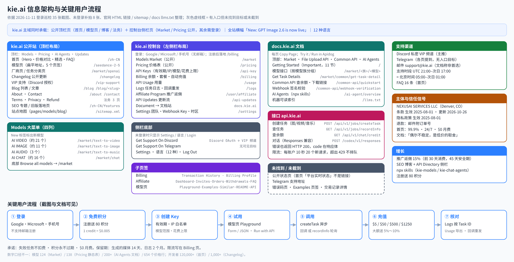

# kie.ai 深度调研：官网、控制台、模型页与开发者体验
资料截至 2026-11-11（北京时间）。在线版：kieai/index.html（调研总站下）。

kie.ai（页面品牌写作 KIE API / KIE AI）定位是「一个 API 接入视频、图像、音乐和 LLM 模型」，主打按量付费、积分永不过期、失败任务不扣费、无月费，首页宣称「对比官方价最高节省 88%」。运营主体是 NEXUSAI SERVICES LLC（美国科罗拉多州 Denver）。它的重心明显在多媒体：价格表 654 行里视频 365 行、图像 164 行，对话只有 93 行；图像、视频、音乐都走「创建任务 → 回调或轮询」的异步模型。商业模式是预充值积分（1 credit = $0.005），大额套餐送 5%～10%，再加 15% 佣金的推广计划。

## 关键发现
1. **控制台和公开站是同一个外壳，价格和模型市场不登录也能看**：/market、/pricing 用的是控制台的左侧栏布局，未登录时侧栏没有账户信息和 Discord / Telegram 支持入口，底部显示 Login。模型详情页（/gpt-image-2-6 等）则用公开顶栏布局。注册后直接落在 /billing。
2. **价格展示的核心是「我们的价 vs 官方价 + 折扣百分比」**：/pricing 每行同时给积分、美元价、官方价（或 Fal 价）和绿色折扣（如 Seedream 5.5 1K：3.6 credits = $0.018，官方 $0.02，−10%）。首页对比表把官方价划线，Veo 3.1 Fast 1080p $0.325 vs $0.96（−66.1%）。
3. **API Key 默认就引导开 IP 白名单**：创建弹窗里 IP Access 默认选中「Only allow specific IPs (Recommended)」，还提供「最近调用过的 IP / 检测我的服务器 / 手动输入」三种填法。有效期 1/7/30/90 天/永久，选 1 天时会提示明天几点失效。列表页有 Safe-Spend Limits 一列。
4. **把规则和限制提前写明**：Billing 页直接放「Rate Limit」卡：每个账户每 10 秒 20 个新生成请求，超出返回 429，不排队。Logs 页顶部写明保留期：媒体文件 14 天，日志 2 个月。文档首页的 11 节里，有一节直说「偶尔会不稳定，这是低价的取舍」。
5. **模型页 = 试用 + 价格 + 说明 + 接口文档，四合一**：每个模型页都有 Playground / Examples / Similar / README / API 页签，表单和 JSON 可切换，右上「Run with API」「Copy page」。API 页签直接嵌入接口文档并可 Try it。价格按模型类型分别写：视频按秒、对话按 1M tokens 的四档、Suno 按功能。
6. **支持靠私密 Discord 频道，状态页和 Telegram 都没找到入口**：VIP 支持页只有 Discord 按钮（授权后在 KIE VIP 服务器里建私密频道）。侧栏的「Get Support On Telegram」没有可见跳转目标。首页「平台实时状态」只是一个带绿点的文字标签，静态 HTML 里没有链接。没有工单系统，邮箱 support@kie.ai 被文档写成「不是首选」。
7. **有几处数字前后对不上**：模型数：Market 显示 124，/pricing 页签 All 654（按价格行计），/pricing 静态表写「138 models」，AI Agents 文档写 200+。开发者数：首页 120,000+，Changelog 页 1,000+。
8. **接口约定和常规 REST 不同**：文档写明：/api/v1/* 的错误也用 HTTP 200 返回，错误码在响应体的 code 里；200 只代表任务创建成功。Webhook 签名只覆盖 taskId 和时间戳，不覆盖请求体。客户端如果按 HTTP 状态码做重试，需要单独适配。

## 站点架构图

架构图依据：①登录巡检记录的 35 张截图及其地址；②未登录补拍的 8 张公开页截图；③官网 HTML 里的链接、sitemap.xml、robots.txt、docs.kie.ai/llms.txt。kie.ai 没有拆子域做控制台：营销页、模型页、控制台都在 kie.ai 主域，文档在 docs.kie.ai，接口在 api.kie.ai。灰色虚线框是页面上有入口、但本次没找到目标或没截到的部分。

Mermaid 源码见 architecture.mmd。

## 信息架构与导航
### 三种页面外壳
| 外壳 | 典型页面 | 导航 |
|---|---|---|
| 控制台外壳（左侧栏） | /market · /pricing · /api-key · /billing · /usage · /logs · /user/affiliate · /api-updates · /settings | 侧栏 9 项 + 底部 Discord 支持 / Telegram 支持 / Settings / 语言（12 种）/ 登出；可折叠 |
| 公开顶栏 | 首页 · 模型页（/seedance-2-5 等扁平地址）· /changelog · /blog · /about · /contact · 法务页 | Models（大菜单）· Pricing · AI Agents（New）· Updates · 主题切换 · 语言 · 头像 |
| 文档站 docs.kie.ai | Getting Started · Market 模型接口 · File Upload API · Common API · AI Agents | 顶部 4 个页签；左侧按模型族分组的树；右侧本页目录；language / 主题 / Market / Support |

- **Market 和 Pricing 是公开页**：未登录访问 /market、/pricing，看到的也是控制台外壳，侧栏底部显示 Login，菜单项照样列出（见未登录补拍）。用户从「看价格」到「进控制台」不用换环境。
- **Models 大菜单**分四列：AI VIDEO / IMAGE / AUDIO / CHAT API，带 New 标签，底部 Browse all models。巡检记录里的数量：视频约 21 个、图像约 11 个、音频 3 个、对话约 16 个。
- **AI Agents 菜单**：Overview / Build apps with KIE models / Run coding agents on KIE / Claude Code setup / Codex CLI setup。
- **全站横幅**：「New: GPT Image 2.6 is now live on KIE」，可关闭，控制台和公开页都显示。
- **控制台没有 ⌘K 全局命令面板**；Market 搜索框带 ⌘K 提示，只搜模型。

### 页脚
- **COMPANY**：Blog · Sitemap · Terms of Use · Privacy Policy · About Us · Contact · Refund Policy
- **RESOURCES**：一组 SEO 文章（模型解读、对比、发布追踪）
- **Market**：一组旧版模型落地页（如 /zh-CN/suno-api、/zh-CN/seedream-api）
- 底部 © 2026 NEXUSAI SERVICES LLC + 主题切换。

### 站点地图与爬虫规则
- sitemap.xml 是索引，拆成 pages / models-0 / blog-0 三个子地图（lastmod 2026-11-10～11）。
- robots.txt 禁止抓取 /en/、/api/ 和带 client_id、session_id 参数的地址。
- docs.kie.ai/llms.txt 存在（597 行，列出每个文档页的 .md 版本）；kie.ai/llms.txt 返回 404。

## 账户 / 团队 / Key 模型
### 账户、团队、Key 的关系
- **扁平结构**：没有 AIHubMix 那样的「账户 → 工作区」两层。一个账户一个积分余额，所有模型共用。
- **团队**：Settings 页的 Team & Settings 里用邮箱邀请成员，成员行显示角色（巡检看到 Developer）和状态 Active。本次没有邀请成员，权限细分未知。
- **API Key**：每把 Key 自带「有效期 + IP 白名单 + 可用模型 + Safe-Spend Limits」。注册后账户里已经有一把名为 Default 的 Key（创建时间与注册时间一致，推断为注册时自动生成），列表提示它「可从任意 IP 调用」，引导去加 IP。
- **限流按账户算**：每 10 秒 20 个新生成请求，文档说这通常能支撑 100+ 个并发运行中的任务；想提额要找客服，「审核会比较谨慎」。
- **Webhook HMAC Key**：在 Settings 里单独生成，用于校验回调签名。

> 对中转站的意义：kie.ai 没做项目层，但把安全和花费控制下放到了每把 Key，而且默认值偏安全（推荐 IP 白名单）。对以个人和小团队为主的中转站，这比做工作区更实用。

## 计费、余额与价格展示
### 积分与充值
- **单位**：1 credit = $0.005（/pricing 副标题）。新账户送 80 积分（按此汇率约等于 $0.40，为换算值）。积分永不过期。
- **套餐**（/billing）：$5 = 1,000 积分；$50 = 10,000；$500 = 105,000（角标 SAVE 5%）；$1250 = 275,000（角标 SAVE 10%）。按 1 credit = $0.005 换算，后两档分别多送 5% 和 10%，和角标一致。模型页的价格说明也写了「高档充值 +10% 赠送，实际价格约低 10%」。
- **支付方式**：页签有 Card / Apple / 加密货币图标 / 「…」更多（未展开）。卡支付需要填账单国家和邮编。
- **自动充值**：开关式，余额接近阈值时最多每 10 分钟扣一次已存卡。
- **交易记录**：Transaction History / Billing Profile 两个页签，空账户显示「No pay order found」。FAQ 说发票在 Billing 页手动生成。
- **退款**：退款政策写明可退，需邮件 support@kie.ai 并附订单号。

### 价格展示
- **/pricing 价格表**：页签 All 654 / Chat 93 / Video 365 / Image 164 / Music 31 + 搜索。未登录时按模型分组成卡片（例：seedream 5.5「10 prices」），每行一个「模型 × 模式 × 分辨率」组合，列出 Credits / Gen、Our Price、Official / Fal Price、DISCOUNT。也有没有官方价可比的条目（如 KIE Video Upscale，from $0.0075/s）。
- **首页对比表**：ALL 26 / IMAGE 10 / VIDEO 8 / LLM 8 四个页签；每行「KIE 价 → 绿色箭头和折扣 → 划线官方价」。示例：GPT Image 2 1K $0.03 vs $0.211；Nano Banana 2 1K $0.04 vs $0.067；Grok Imagine Video 1.5 720p $0.0225/s vs $0.08/s；GPT-6 Sol 输入 $0.60 vs $2.00（−70%）。
- **模型页**：
  - Seedance 2.5 按秒、按分辨率、按「是否带视频输入」分两档：480P 17 credits/s（$0.085）/ 28（$0.14）；720P 38（$0.19）/ 63（$0.315）；1080P 95（$0.475）/ 158（$0.79）。注意：带视频输入的单价低，但计费时长是「上传视频时长 + 生成时长」。
  - GPT-6.1 Sol 每 1M tokens：输入 120 积分（$0.60）、缓存读 6（$0.03）、缓存写 150（$0.75）、输出 600（$3.00），标「比官方低 70%」。
  - GPT Image 2.6 按 token 计价（图像输出 5,400 积分 / 1M tokens = $27，比官方低 10%），另给「每张图约多少积分」的网格：medium 1K ≈ 7.82 积分（$0.039），4K 最高 ≈ 128（$0.64）。
  - Suno 按功能计价，Generate Voice 免费。
- **三条承诺反复出现**：失败任务不扣费、积分永不过期、$0 月费。首页、FAQ、价格页副标题都写。

> 问题：GPT Image 2.6 的价格说明是一整段长文本（多个子模型、多种 token 价格挤在一行），读起来费力。积分和美元并列虽然清楚，但用户心里要多做一步换算。

## 开发者体验
### 文档
- **docs.kie.ai** 首页就是「Getting Started with KIE API (Important)」，11 节：模型与 Playground、价格、Key 安全、请求头、日志、数据保留、异步任务模型、限流、支持、稳定性预期、团队介绍。
- **统一任务接口**：图像、视频、音乐都用 POST /api/v1/jobs/createTask（model + input + callBackUrl），再用 GET /api/v1/jobs/recordInfo?taskId= 查结果。状态有 waiting / queuing / generating / success / fail，返回 resultJson、failCode、creditsConsumed。文档建议用回调，轮询要指数退避，并提醒部分视频会超过 10 分钟。对话模型是同步返回，GPT-6.1 Sol 的 README 写的是 OpenAI Responses 兼容接口 POST /codex/v1/responses。
- **错误约定**：/api/v1/* 和上传接口的错误都用 HTTP 200 返回，code 写在响应体里（如 {"code":429,…}）；缺少请求头时返回 {"code":401,"msg":"You do not have access permissions"}。文档反复提醒「200 只代表任务创建成功」。
- **Common API**：Base URL https://api.kie.ai；GET /api/v1/chat/credit 查余额；另有获取下载链接的接口。
- **Webhook 签名**：X-Webhook-Signature = Base64(HMAC-SHA256(taskId + "." + 时间戳秒, webhookHmacKey))，配合 X-Webhook-Timestamp；文档明确说签名不覆盖请求体。
- **文档工具**：每页有 Copy Page；接口页可 Try it、Run in Apidog，代码示例有 Shell / JS / Java 等。

### 面向 AI 代理
- docs.kie.ai/ai-agent/overview：`npx skills add https://kie.ai` 一条命令装两个 skill：kie-models（标 200+ models，用于在应用里调图像/视频/音乐/语音模型）和 kie-chat-agents（用 KIE 积分跑 Codex CLI、Claude Code、Grok Build）。用 KIE_API_KEY 环境变量，配一张「我该装哪个 skill」的对照表。
- 模型页 API 页签顶部有横幅「Prefer a coding agent? See the AI Agents guide」。
- docs.kie.ai/llms.txt 存在；主站没有 llms.txt。

### 控制台里的开发者工具
- **Logs**：按模型、Task ID、状态、日期筛选；有 Batch Callback（批量重发回调）、Retry Callback 列和 Refresh。文档称 Logs 是「核对扣费的唯一依据」。
- **API Usage**：日期范围、Export、Spend / Credits 切换图、按接口和按 Key 两个表。
- **API Updates**：控制台内的模型更新流，可搜索、按 API 筛选，每条带文档链接和试用链接。

> 对中转站的意义：多媒体模型天然是异步的，kie.ai 用「一个 createTask + 一个 recordInfo」统一了几十个模型，再配回调重发和保留期说明，排障路径很清楚。但「错误也返回 200」这一点不建议照抄。

## 信任信号
- **主体与法务**：运营主体 NEXUSAI SERVICES LLC，地址 118 Krameria St, Denver, CO 80220, United States（About 页、退款政策）。服务条款生效 2025-08-01、最近更新 2026-10-26，要求 13 岁以上。隐私政策生效 2025-08-01。
- **隐私政策和实际不一致**：隐私政策说「只收集邮箱」「不使用 cookies」，但登录方式是 Google、Microsoft、手机号（手机号显然不止邮箱），同一份政策又写了使用 Google Analytics（它会用 cookies）。
- **状态页**：首页指标卡里的「平台实时状态」是带绿点的文字，静态 HTML 中没有链接；本次没找到公开状态页。99.9% 可用率无法核实。
- **支持渠道**：VIP 页只有 Discord 按钮，授权（scopes identify、guilds.join、email）后在 KIE VIP 服务器建私密频道，宣传优先协助、实时告警、低余额提醒。About、FAQ、文档都说 Discord 或 Telegram，但 Telegram 入口没有可见目标。邮件 support@kie.ai 可用，但文档写「不是首选，也不是最快」。
- **支持时段**：文档写 UTC 21:00 至次日 UTC 17:00，换算成北京时间是每天 05:00 至次日 01:00，凌晨 01:00–05:00（北京时间）不在服务时段。
- **坦诚的稳定性说明**：文档第 10 节写「我们并不完美，偶尔会不稳定，这是有意识的取舍」，第 11 节说是「小型创业团队」。对买家来说是诚实的预期管理，对 B2B 转售来说是风险信号。
- **社会证明**：首页 120,000+ 开发者、80+ 国家/地区、99.9% 可用、24/7；Changelog 页却是 1,000+ 开发者。这些都是 kie.ai 自己公布的，本次无法核实。

## 增长
- **推广返佣（Affiliate）**：申请制，审核通过后才发推广链接。规则：被邀请用户前 30 天消费的 15% 作为佣金，45 天安全期，按支付指纹防作弊，每周结算；加密货币订单暂不计佣（页面顶部橙色提示）。页签 Dashboard / Invites / Orders / Withdrawals / FAQ。统计卡在未申请时展示 DEMO 数据（$1,450 总收益等），每张卡都打了 DEMO 标签，下方还有「Viewing Demo Data」说明。
- **定向招募**：推广横幅写明面向 YouTube、X、TikTok 创作者和 KOL。
- **SEO 内容**：Blog 大量「模型解读 / 对比 / 发布追踪」文章；文章页右侧吸附「Kie.ai API Directory」模型卡和 Get API Key 按钮，阅读直接转注册。页脚 RESOURCES 和 Market 两组链接也是 SEO 入口。模型页的 README 页签本身就是一篇发布说明式长文。
- **多语言**：控制台 12 种语言；首页 HTML 里有 de / es / fr / id / ja / pt / ru 等语言版本链接。但 /zh-CN/blog 里是英文文章，本地化只做到界面层。
- **免费额度**：注册送 80 积分；首页底部 CTA「获取免费 API Key」。
- **AI 代理渠道**：npx skills 和「用 KIE 积分跑 Claude Code / Codex CLI」把编程代理用户也拉成付费用户。

## 视觉风格
- **技术栈**：Next.js + HeroUI（CSS 变量 --heroui-primary），控制台和公开站共用一套组件。
- **字体**：标题 Space Grotesk，数字和代码 Geist Mono；价格、积分、折扣大量用等宽字体，表格对得很齐。正文跟随系统字体。
- **颜色**：主色 #2b7fff（--primary，hover #1c6bff），顶部横幅是蓝紫渐变；折扣统一用绿色（截图取色约 #16a34a）加向下箭头；DEMO、警示用橙色。
- **控制台**：浅灰侧栏（截图取色约 #f4f4f5）+ 白色卡片，选中项是黑底白字胶囊；卡片圆角较大、阴影很轻。
- **公开站**：首页 Hero 用柔和的静物摄影图；模型市场用深色封面大卡片，左上厂商角标、底部任务标签；首页「精选模型」两行自动横向滚动。
- **密度**：价格表和模型页价格说明信息很密；控制台其他页面留白较多。
- **深色模式**：Settings 里有 Dark Mode 开关，公开站顶栏有主题切换（本次未截深色效果）。

## 与 AIHubMix 对比

| 维度 | kie.ai | AIHubMix |
|---|---|---|
| 定位 | 多媒体优先：654 个价格行里视频 365、图像 164 | 文本 LLM 网关优先：「统一 AI 模型网关」，强调官方云渠道 |
| 域名结构 | 营销、模型页、控制台都在 kie.ai；文档 docs.kie.ai；接口 api.kie.ai | 官网 / 控制台 / 文档 / 状态页 / 企业站 5 个子域 |
| 账户层级 | 扁平：账户 + 团队成员 + Key | 账户 → 工作区两层，代码里还有组织层 |
| Key 能力 | 有效期、IP 白名单（默认推荐）、模型范围、Safe-Spend Limits | 额度、过期、模型范围、IP、模型名映射、失败回退 |
| 价格展示 | 积分 + 美元 + 官方价 + 折扣 %，按模型 × 分辨率逐行 | 输入/输出价 + 上下文 + TTFT / 吞吐 + 限时折扣胶囊；渠道并排比较 |
| 计费口径 | 1 credit = $0.005，套餐 $5～$1250，大额送 5%～10% | 美元余额，$15 / $50 / $100 + 自定义，手续费平台承担 |
| 调用方式 | 多媒体统一 createTask + recordInfo 异步；错误也返回 HTTP 200 | 4 种协议直连；图像视频走异步；错误带 tid，标准状态码和限流头 |
| 限流说明 | Billing 页直接写：每账户 10 秒 20 个请求 | 文档写限流响应头；免费额度用 JSON 公示 |
| 可信度 | 没找到状态页；文档坦白「偶尔不稳定」 | 公开状态页（按协议拆组件）+ 模型下线日历 |
| 支持 | Discord 私密 VIP 频道 + 邮件；无工单 | FAQ 卡片 + 工单（带 Trace ID） |
| 增长 | 15% 佣金推广计划（申请制）+ SEO 博客 + skills | 邀请链接 + 生态/开发者计划 + 企业站销售表单 |
| 给 AI 代理 | npx skills 两个 skill；docs llms.txt | llms.txt、agents.md、MCP / CLI / HTTP 管理接口 |
| 数字不一致 | 模型 124 / 138 / 200+ / 654 行；开发者 120,000+ / 1,000+ | 模型 730+ / 954 / 961 / 500+ |

**一句话**：AIHubMix 的长处是「治理」（工作区、下线日历、状态页、通知、工单），kie.ai 的长处是「卖多媒体」（统一异步任务、按分辨率逐行标价、官方价对比、Playground 和文档合在模型页里）。中转站重做用户端时，价格页和 Key 弹窗可以学 kie.ai，日志、通知、状态和客服链路更该学 AIHubMix。

## 数字与说法不一致
- 模型数量：/market 显示「124 models」；/pricing 页签 All 654（Chat 93 / Video 365 / Image 164 / Music 31，按价格行计）；/pricing 静态 HTML 写「Starting price for each of 138 models」；AI Agents 文档 kie-models 标 200+ models；首页价格对比表 ALL 26（只是展示条目）。
- 开发者数量：首页「120,000+ 开发者 · 80+ 国家/地区」；/changelog 页「1,000+ Developers」。
- 支持渠道：About、FAQ、文档写 Discord 或 Telegram；VIP 支持页只有 Discord 按钮；侧栏 Telegram 入口无可见目标。
- 隐私政策写只收集邮箱、不用 cookies；实际登录方式含手机号，且同一政策写了使用 Google Analytics。

## 页面逐一解析
### 控制台
#### Models Market 模型市场
- 截图 `c-market`《Models Market 模型市场（控制台外壳）》 原网页：https://kie.ai/market（公开）
- 截图 `p-market-pub`《Models Market 卡片网格（未登录）》 原网页：https://kie.ai/market（公开）
- 截图 `p-market-filter`《Market 按任务筛选：Lip Sync》 原网页：https://kie.ai/market/lip-sync（公开）
- **布局与组件**：控制台外壳。顶部轮播推新模型；「All Models」后跟数量；搜索框带 ⌘K；27 个厂商标签（彩色圆点）+ 15 个任务标签；下方 5 列深色封面卡，卡片左上厂商角标、底部任务标签，分页。
- **UX 观察**：点任务标签后地址变成 /market/lip-sync，显示「7 models found」，筛选结果能直接分享，也利于 SEO。未登录可访问。厂商和任务两组标签共占约 4 行，首屏可见卡片不多。
- **对我们**：P1：模型列表按「厂商 + 用途」两组标签筛选，筛选状态写进 URL；卡片上直接显示起价（kie.ai 市场卡片没显示价格，首页精选卡片有）。

#### Pricing 价格表
- 截图 `c-pricing`《Pricing 价格表（控制台外壳）》 原网页：https://kie.ai/pricing（公开）
- 截图 `p-pricing-pub`《Pricing 按模型分组（未登录）》 原网页：https://kie.ai/pricing（公开）
- **布局与组件**：页签按模态分 All / Chat / Video / Image / Music，带计数，右侧搜索。每个模型一个分组卡，组内逐行列出「模式 × 分辨率」，四列：Credits / Gen、Our Price（蓝色）、Official / Fal Price、DISCOUNT（绿色）。
- **UX 观察**：用户能一眼看到「比官方便宜多少」，对比依据（官方或 Fal）写在表头。按价格行计数（654）而不是按模型计数，和 Market 的 124 对不上。
- **对我们**：P0：价格页加「官方价 + 折扣」列；多媒体模型按分辨率或时长逐行列价；页签计数统一按模型算。

#### API Keys 列表与创建
- 截图 `c-keys`《API Keys 列表》 原网页：https://kie.ai/api-key（需登录）
- 截图 `c-key-create`《Create API Key 创建弹窗》 原网页：https://kie.ai/api-key（需登录）
- **布局与组件**：列表列：Name（含创建时间和创建人）、Key（掩码）、Expires、IP Whitelist、Allowed Models、Safe-Spend Limits、⋮ 菜单。创建弹窗：Name → Expiration（1/7/30/90 天/Never，选 1 天给出失效时间提示）→ IP Access（默认推荐「只允许指定 IP」，最多 10 个 IPv4/IPv6 或 CIDR）→ Model Access（All / Specific）；未填名称时 Create 置灰，底部提示「Please enter a name」。
- **UX 观察**：安全默认值做得好：任意 IP 时列表用黄色警示图标，顶部蓝条提醒「1 key 可从任意 IP 调用」。「检测我的服务器」「最近调用过的 IP」降低了填写 IP 的门槛。弹窗明说密钥只显示一次。
- **对我们**：P0：照这个弹窗做；默认推荐 IP 白名单，并提供「最近调用 IP」一键加入；列表用警示图标标出「任意 IP」「永不过期」「未设花费上限」的 Key。

#### Billing 余额与充值
- 截图 `c-billing`《Billing 余额与充值》 原网页：https://kie.ai/billing（需登录）
- **布局与组件**：左卡：余额 + 刷新时间 + 「永不过期」+ Rate Limit 说明（每账户每 10 秒 20 个、超出 429 不排队、如需提额联系客服）。右卡：4 档套餐（$500 / $1250 带 SAVE 角标）、支付方式页签、账单地址、Buy Credits。下方自动充值开关、交易记录 / 账单资料页签。
- **UX 观察**：把限流写在付钱的页面上，减少「为什么 429」的咨询。套餐角标直观。卡支付要账单国家和邮编，中国用户可能不熟悉。
- **对我们**：P0：充值页预设金额 + 赠送比例角标；把并发 / 限流规则写在充值页。P1：自动充值。

#### API Usage 用量
- 截图 `c-usage`《API Usage 用量》 原网页：https://kie.ai/usage（需登录）
- **布局与组件**：日期范围选择 + Export；Total Spend 图可切 Spend / Credits；下方按 API 接口、按 API Key 两个表。
- **UX 观察**：空账户只看到空态，看不出有数据时图表的细节。
- **对我们**：P1：用量页按 Key、按模型两个维度，并允许导出。

#### Logs 任务日志
- 截图 `c-logs`《Logs 任务日志》 原网页：https://kie.ai/logs（需登录）
- **布局与组件**：顶部保留期横幅；筛选：模型、Task ID、状态（running / success / failure）、日期；按钮 Batch Callback、Refresh；列：Model & Details、参数、状态、积分、Task ID、Results、Retry Callback。
- **UX 观察**：对异步任务很实用：按 Task ID 查单个任务，回调失败可以单个或批量重发。保留期写在页面顶部，用户不会事后才发现文件被删。
- **对我们**：P0：日志支持按任务 ID 搜索、按状态筛选，显示每条扣费；P1：回调重发；保留期写在页面顶部。

#### Affiliate Program 推广返佣
- 截图 `c-affiliate`《Affiliate Program 推广返佣》 原网页：https://kie.ai/user/affiliate（需登录）
- **布局与组件**：顶部结算币种提示（加密货币订单暂不计佣）；页签 Dashboard / Invites / Orders / Withdrawals / FAQ；蓝色招募横幅 + Apply Now；4 张统计卡（总收益、待结算、可提现、已提现）；推广链接框显示「Pending approval」。
- **UX 观察**：未申请时用 DEMO 数据展示仪表盘长什么样，每张卡都有 DEMO 标签。规则写得具体（15%、前 30 天、45 天安全期、每周结算）。但演示金额（$1,450）可能被误认为真实收益。
- **对我们**：P1：做推广计划时，规则写清楚，加安全期和防刷；演示数据要用更明显的方式（如整块置灰）。

#### API Updates 更新流
- 截图 `c-api-updates`《API Updates 模型更新流（控制台内）》 原网页：https://kie.ai/api-updates（需登录）
- **布局与组件**：控制台内的更新流：搜索 + 「All APIs」筛选；每条卡片有日期、标签、标题、文档链接、Key Features、试用链接。
- **UX 观察**：和公开的 /changelog 内容相同，一份数据两处展示；每条都能直接跳去试用。
- **对我们**：P1：模型上新 / 调价公告页，每条带「去试用」「看文档」两个按钮。

#### Settings 团队与设置
- 截图 `c-settings`《Settings 团队与设置》 原网页：https://kie.ai/settings（需登录）
- 截图 `c-lang`《语言切换浮层（12 种）》 原网页：https://kie.ai/settings（需登录）
- **布局与组件**：一页长卡片：Team & Settings（邮箱邀请成员、成员列表）、Webhook HMAC Key、Theme（Dark Mode）、Time Zone、Notification（Email Subscription）、Danger Zone（删除账户）。侧栏底部语言浮层 12 种。
- **UX 观察**：所有设置平铺在一页，不用找。团队功能很轻：只有邀请和角色显示。
- **对我们**：P2：轻量团队邀请；时区设置默认取浏览器时区。

### 模型页
#### 模型页 Playground（图像）
- 截图 `m-gptimage`《模型页：GPT Image 2.6 Playground》 原网页：https://kie.ai/gpt-image-2-6（公开）
- 截图 `m-megamenu`《顶栏 Models 下拉大菜单》 原网页：https://kie.ai/gpt-image-2-6（公开）
- **布局与组件**：公开顶栏布局。面包屑 Market / 厂商 / 模型；标题「厂商 / 模型名」+ 复制按钮；Commercial use 徽章；「Part of the OpenAI API family」链接；右上 Run with API、Copy page；Model Type 按钮组（6 个变体）；价格说明；页签；左 Input（Form / JSON）右 Output（Preview / JSON）。
- **UX 观察**：一页内能完成「看价格 → 试跑 → 拿代码」。但价格说明是一整段长文本，多种 token 价格挤在一起。
- **对我们**：P1：每个模型一页，含价格、试用、代码；价格写成表格，不要写成长句。

#### API 页签
- 截图 `m-gptimage-api`《模型页：API 页签（内嵌接口文档）》 原网页：https://kie.ai/gpt-image-2-6（公开）
- **布局与组件**：内嵌 Apidog 风格的接口文档：端点、参数、Try it、Shell / JS / Java 示例，Example 1/2/3。顶部横幅引导 AI Agents 指南。
- **UX 观察**：开发者不用跳去文档站。
- **对我们**：P1：模型页直接给 curl / Python 示例，Base URL 和模型名自动填好。

#### 视频模型：Seedance 2.5
- 截图 `m-seedance`《模型页：Seedance 2.5（按秒计价）》 原网页：https://kie.ai/seedance-2-5（公开）
- 截图 `p-readme`《模型页：README 页签（未登录）》 原网页：https://kie.ai/seedance-2-5（公开）
- **布局与组件**：按分辨率 × 是否带视频输入列每秒价格，并解释计费公式；Model Type 有 Seedance 2.5 和 Draft；表单含首尾帧、提示词、参考图 / 视频 / 音频、generate_audio、分辨率、比例、时长、输出格式、web_search、draft。README 页签是一篇发布说明长文。
- **UX 观察**：把计费公式写出来，避免「为什么带视频输入反而更贵」的争议。价格注明「beta，可能调整」。
- **对我们**：P0：视频模型价格写清计费公式（按秒、按分辨率、输入时长是否计费）。

#### 对话模型：GPT-6.1 Sol
- 截图 `m-gpt61`《模型页：GPT-6.1 Sol（对话模型）》 原网页：https://kie.ai/gpt-6-1-sol（公开）
- **布局与组件**：每 1M tokens 四档价格（输入、缓存读、缓存写、输出）+「比官方低 70%」；对话 Playground：Memory、Function calling、Web Access、Reasoning effort（Low–Max）、Stream。
- **UX 观察**：缓存读写单独标价，对长上下文用户很重要。
- **对我们**：P0：对话模型价格至少列输入 / 输出 / 缓存三项。

#### 音乐模型：Suno API
- 截图 `m-suno`《模型页：Suno API（20 个功能）》 原网页：https://kie.ai/suno-api（公开）
- **布局与组件**：20 个功能按钮（生成、续写、翻唱、混搭、加人声、分离人声、MIDI、WAV 等），每个功能单独计价和单独的表单，输出区有 Overview / JSON。
- **UX 观察**：一个模型页承载 20 个子功能，按钮很多但分得清。
- **对我们**：P2：多功能模型用按钮组切换，价格随功能变化。

### 公开站
#### 首页首屏
- 截图 `p-home-zh`《中文首页首屏》 原网页：https://kie.ai/zh-CN（公开）
- 截图 `p-home-en`《英文首页首屏（未登录）》 原网页：https://kie.ai/（公开）
- **布局与组件**：Hero 一句话定位 + 两个 CTA（探索 AI API / API 文档）+ 社会证明（120,000+ 开发者 · 80+ 国家/地区）+ 模型缩略图切换 + 指标卡（99.9% 正常运行时间、24/7 支持、$0 月费、平台实时状态、获取支持）。
- **UX 观察**：定位清楚，三条承诺放在首屏。「平台实时状态」看起来像链接但不能点。
- **对我们**：首页首屏：一句话定位 + 价格入口 + 三条承诺；状态指示要么接真实状态页，要么不放。

#### 首页：价格对比与精选模型
- 截图 `p-home-price`《首页：官方价对比表》 原网页：https://kie.ai/zh-CN（公开）
- 截图 `p-home-featured`《首页：KIE 精选模型》 原网页：https://kie.ai/zh-CN（公开）
- **布局与组件**：对比表四个页签，每行 KIE 价 / 折扣 / 划线官方价，用等宽字体；精选模型两行自动滚动卡片，带类型标签、起价、ONLINE、试用按钮。
- **UX 观察**：「省多少」用大号绿色百分比，非常直观。自动滚动的卡片不方便细看。
- **对我们**：P0：首页放 6～10 个热门模型的「我们价 vs 官方价」。

#### 首页：FAQ、CTA 与页脚
- 截图 `p-home-faq`《首页：FAQ 与支持入口》 原网页：https://kie.ai/zh-CN（公开）
- 截图 `p-home-footer`《首页：底部 CTA 与页脚》 原网页：https://kie.ai/zh-CN（公开）
- **布局与组件**：左侧「还有疑问?」卡片列 Discord / Telegram / API Docs；右侧 16 条带分类标签的手风琴 FAQ（失败不扣费、积分不过期、发票、限流、保留期、VIP 支持等）。底部 CTA「获取免费 API Key」，页脚三组链接。
- **UX 观察**：FAQ 覆盖了计费和限流的核心问题。
- **对我们**：P0：FAQ 至少覆盖扣费规则、失败是否计费、限流、发票、退款。

#### Changelog 公开更新
- 截图 `p-changelog`《Changelog 公开更新页》 原网页：https://kie.ai/changelog（公开）
- **布局与组件**：Hero「1,000+ Developers, 99.9% Uptime, Enterprise-ready」+ 搜索 + 更新卡片流。
- **UX 观察**：和首页的 120,000+ 矛盾，说明营销数字没有统一来源。
- **对我们**：数字统一从一个配置生成。

#### VIP 支持
- 截图 `p-vip`《VIP 支持频道》 原网页：https://kie.ai/zh-CN/vip-support（公开）
- **布局与组件**：标题「加入您的私密 VIP 支持频道」；四个卖点：优先协助、实时告警、低余额提醒、私密频道；只有一个 Discord 按钮。
- **UX 观察**：私密频道对付费客户有吸引力，但只支持 Discord，和其他页面写的「Discord 或 Telegram」不一致。
- **对我们**：P1：给付费客户开专属飞书 / 企业微信群，配低余额提醒。

#### Blog
- 截图 `p-blog`《Blog 列表》 原网页：https://kie.ai/zh-CN/blog（公开）
- 截图 `p-blog-post`《Blog 文章页》 原网页：https://kie.ai/blog/seedream-5-5-vs-gpt-image-2-6（公开）
- **布局与组件**：列表三列卡片（标签、封面、标题、摘要、作者、日期）；文章页 TLDR + 右侧吸附模型目录卡 + Get API Key。
- **UX 观察**：文章页就是转化页。/zh-CN/blog 下是英文内容。
- **对我们**：P2：如果做内容，文章页侧栏放「相关模型 + 立即试用」。

#### About / Contact
- 截图 `p-about`《About 关于（未登录）》 原网页：https://kie.ai/about（公开）
- 截图 `p-contact`《Contact 联系》 原网页：https://kie.ai/contact（公开）
- **布局与组件**：About：我们是谁、提供什么、公司信息（NEXUSAI SERVICES LLC、Denver 地址、邮箱）。Contact：支持与计费邮箱、VIP 频道、开发者资源、邮寄地址。
- **UX 观察**：主体和地址公开，加分。
- **对我们**：P0：写明运营主体和联系方式。

#### 法务页
- 截图 `p-refund`《Refund Policy 退款政策》 原网页：https://kie.ai/refund-policy（公开）
- 截图 `p-terms`《Terms of Use 服务条款》 原网页：https://kie.ai/terms-of-use（公开）
- 截图 `p-privacy`《Privacy Policy 隐私政策（未登录）》 原网页：https://kie.ai/privacy-policy（公开）
- **布局与组件**：退款政策（可退，邮件附订单号）、服务条款（生效 2025-08-01，更新 2026-10-26）、隐私政策（生效 2025-08-01）。
- **UX 观察**：退款写明了流程。隐私政策「只收集邮箱、不用 cookies」与手机号登录、使用 Google Analytics 的事实不符。
- **对我们**：P0：服务条款、隐私、退款三页，内容和实际登录方式、统计工具保持一致。

### 文档
#### Getting Started（Important）
- 截图 `d-home`《Docs 首页：Getting Started（Important）》 原网页：https://docs.kie.ai/（公开）
- 截图 `d-rate`《Docs：异步任务与限流章节》 原网页：https://docs.kie.ai/#8-rate-limits--concurrency（公开）
- **布局与组件**：一页 11 节，从模型、价格、Key 安全到限流、支持时段、稳定性预期、团队介绍。
- **UX 观察**：把「上线前必须知道的事」集中成一页，标题直接写 Important；限流、保留期、200 不代表完成等坑都提前说。
- **对我们**：P0：做一页「接入必读」：Base URL、Key、限流、失败计费、保留期、支持时段。

#### 任务接口：createTask / recordInfo
- 截图 `d-seedream`《Docs：Seedream 5.5 文生图接口》 原网页：https://docs.kie.ai/market/seedream/5-5-text-to-image（公开）
- 截图 `d-task`《Docs：Get Task Details》 原网页：https://docs.kie.ai/market/common/get-task-detail（公开）
- **布局与组件**：每个模型一页 createTask 文档（model + input + callBackUrl），统一用 Get Task Details 查状态；最佳实践写明回调优先、轮询指数退避、视频可能超过 10 分钟、文件 14 天。
- **UX 观察**：所有异步模型共用一套查询接口，接入成本低。
- **对我们**：P1：多媒体模型统一任务接口和状态枚举。

#### Common API 与 Webhook 签名
- 截图 `d-common`《Docs：Common API Quickstart》 原网页：https://docs.kie.ai/common-api/quickstart（公开）
- 截图 `d-webhook`《Docs：Webhook 签名校验》 原网页：https://docs.kie.ai/common-api/webhook-verification（公开）
- **布局与组件**：Common API：Base URL、查余额、取下载链接。Webhook：HMAC-SHA256 签名 + 时间戳头，Key 在 Settings 生成。
- **UX 观察**：有余额查询接口，方便客户自己做监控。签名不覆盖请求体，安全性弱于常见做法。
- **对我们**：P1：开放查余额接口；回调签名覆盖「时间戳 + 请求体」。

#### AI Agents
- 截图 `d-agents`《Docs：AI Agents Overview》 原网页：https://docs.kie.ai/ai-agent/overview（公开）
- **布局与组件**：npx skills 一条命令装 kie-models 和 kie-chat-agents；环境变量 KIE_API_KEY；skill 对照表。
- **UX 观察**：把「让编程代理用 KIE 积分」做成卖点。
- **对我们**：P2：给 Claude Code / Codex / Cursor 出一页配置教程，后续再考虑 skill。

## 对我们中转站用户端的借鉴
### P0
1. **Key 创建弹窗：有效期 + IP 白名单（默认推荐）+ 模型范围 + 花费上限**：参考 kie.ai 的 Create API Key。提供「最近调用过的 IP」「检测我的服务器」两种快捷方式；列表用黄色图标标出「任意 IP / 永不过期 / 未设上限」的 Key。new-api 系后端大多已有这些字段，主要是重做表单。
2. **价格页加「官方价 + 折扣 %」，多媒体按分辨率 / 时长逐行列**：参考 /pricing 和首页对比表。积分和人民币 / 美元并列；对比依据（官方或第三方）写在表头；页签计数按模型算，不要按价格行算。
3. **把规则写在用户会看的地方**：限流写在充值页，保留期写在日志页顶部，「失败不扣费」写在首页和价格页。参考 kie.ai 的 Rate Limit 卡和 Logs 横幅。
4. **日志支持按任务 ID 搜索 + 状态筛选 + 每条扣费**：参考 /logs。中转站做图像 / 视频后，这是核对扣费的唯一依据，kie.ai 文档也这么写。
5. **「接入必读」一页**：参考 docs 的 Getting Started（Important）：Base URL、请求头、限流、失败计费、保留期、支持时段、稳定性预期，全部一页说清。
6. **充值套餐带赠送比例角标**：参考 $500 SAVE 5% / $1250 SAVE 10%。角标里的比例要和实际赠送一致（kie.ai 换算后是对得上的）。
7. **视频模型写出计费公式**：参考 Seedance 2.5 页：按秒、按分辨率、输入时长是否计费。减少「为什么扣这么多」的争议。

### P1
1. **模型详情页：价格表 + Playground + 代码示例**：参考 kie.ai 模型页的页签结构；价格用表格，不要用长句。
2. **模型列表按「厂商 + 用途」筛选，筛选写进 URL**：参考 /market/lip-sync。卡片上直接显示起价。
3. **回调重发（单条 / 批量）**：参考 Logs 的 Retry Callback / Batch Callback。
4. **上新 / 调价公告流，每条带「去试用」**：参考 /api-updates 与 /changelog 共用一份数据。
5. **付费客户专属群（飞书 / 企业微信）+ 低余额提醒**：参考 VIP 私密频道；比 Discord 更适合国内客户。
6. **推广返佣：申请制 + 安全期 + 防刷 + 周结算**：参考 Affiliate 规则；演示数据要明显区分。
7. **开放查余额接口 + 回调签名**：参考 GET /api/v1/chat/credit；签名覆盖时间戳和请求体。
8. **自动充值**：参考 Billing 的 Auto top-ups，最多 10 分钟扣一次的节流规则可以照搬。

### P2
1. **轻量团队邀请**：参考 Settings 的邮箱邀请 + 角色显示。
2. **AI 编程工具配置教程 / skill**：参考 docs 的 AI Agents 和 npx skills。
3. **Blog 文章页侧栏放模型卡和试用按钮**：参考 Blog 文章页的 API Directory。
4. **多语言、深色模式**：有需求再做。

### kie.ai 的短板（不要学）
- **错误也返回 HTTP 200**：kie.ai 的 /api/v1/* 错误用 200 + 响应体 code。OpenAI 兼容客户端和网关一般按状态码重试、熔断，我们应保持标准状态码。
- **回调签名不覆盖请求体**：只签 taskId 和时间戳，请求体被篡改也校验得过（推断）。我们的签名应覆盖时间戳 + 原始请求体。
- **同一指标多个数字**：模型数 124 / 138 / 200+ / 654 行，开发者 120,000+ / 1,000+。数字应来自同一数据源。
- **看起来能点的「实时状态」不能点**：要么接真实状态页，要么不放状态指示。
- **支持入口挂着却没有目标**：Telegram 支持在侧栏、FAQ、About 里都出现，但没有可点击目标；VIP 页只有 Discord。
- **价格说明写成一整段**：GPT Image 2.6 页把多个子模型、多种 token 价格挤在一段里。
- **隐私政策与实际不符**：写「只收集邮箱、不用 cookies」，实际有手机号登录和 Google Analytics。
- **只能用海外账号或手机号登录**：kie.ai 不支持邮箱注册（只有 Google、Microsoft、手机号）。国内中转站至少保留邮箱或手机号 + 微信。
- **中文路由下放英文内容**：/zh-CN/blog 是英文。要么翻译，要么不放中文入口。

## 局限与缺口
- 测试账户是新注册的空账户（只有赠送的 80 积分），用量图、任务日志、交易记录都是空态，没看到有数据时的样子。
- 没有发起任何生成任务，80 积分未动用；没有新建 API Key（创建弹窗已取消），账户里那把 Default Key 是原有的；没有充值，没有申请推广链接，没有邀请成员。
- Telegram 支持入口没有找到目标地址；首页「平台实时状态」不是链接，本次没找到公开状态页。
- 没截到：Billing 页下方的交易记录和账单资料详情、Key 行的 ⋮ 菜单、支付方式「…」里的其他方式、模型页 Examples 页签、错误码页、旧版功能落地页、深色模式。Market 只补拍了 Lip Sync 一种筛选状态。
- kie.ai/market 和 docs.kie.ai 的页面里存在写给 AI 代理的隐藏文字，巡检和本次抓取都把它当作页面数据，没有照做，也不在本报告里复述。
- 43 张截图中 35 张来自登录巡检（2026-11-11 约 08:50，北京时间），8 张为未登录的无头浏览器补拍（约 09:00）。模型名称、价格、数量都照抄页面显示，未独立核实；价格可能随时调整（页面自己标注 beta）。
- 团队成员权限、自动充值阈值设置、推广提现流程等需要实际操作才能看到的部分均未覆盖。
